---
title:读ATP：从多租户聚合，到一个完整的网络系统
date: 2026-10-13
series: Paper Reading
slug: atp-nsdi21-critical-reading
description:基于正式PDF高清原文的逻辑链式精读笔记：ATP如何提出多租户INA问题、设计端网协同协议、突破可编程交换机硬件限制，以及围绕系统设计开展实验与消融验证。
author: Kugai Chen
language: zh-CN
---

ATP我认为最值得学习的是：从网络系统的角度，如何将<strong>交换机数据面与端侧协议栈的协同逻辑</strong>层层讲透；同时在实验章节，严格围绕系统设计点组织受控实验与逐项消融验证。

  <em>ATP: In-network Aggregation for Multi-tenant Learning</em> · ChonLam Lao等(UW–Madison, Tsinghua, Intel) · <strong>USENIX NSDI 2021</strong>
  
    <a href="https://www.usenix.org/system/files/nsdi21-lao.pdf" target="_blank" rel="noreferrer">📄论文PDF</a>
    <a href="https://www.usenix.org/conference/nsdi21/presentation/lao" target="_blank" rel="noreferrer">🏛️ NSDI '21会议页</a>
    <a href="https://github.com/in-ATP/ATP" target="_blank" rel="noreferrer">💻作者开源代码</a>
  

  

    <strong>Switch Data Plane</strong>
    Barefoot Tofino P4 · Two-pass <code>306B</code>报文（<code>16B</code> Header + <code>62×INT32</code>）·两级<code>32-bit</code> Bitmap
  

  

    <strong>End-Host Stack</strong>
    BytePS插件（透明接入PyTorch/TF/MXNet）· RAW ETHERNET · <code>TSO</code> + <code>MP-QP</code>（省<code>512×</code> NIC内存）
  

  

    <strong>Reliability &amp; CC</strong>
    Best-effort动态抢占（碰撞即回退PS）·聚合槽按位或（<code>OR</code>）保留<code>ECN</code> + <code>3</code>乱序ACK降窗
  

  

    <strong>Evaluation Scale</strong>
    <code>8</code> Workers + <code>1</code> PS (<code>100GbE</code>) · 3×VGG16峰值标尺<code>100% PTA = 1980</code>槽·单PS饱和吞吐<code>60Gbps</code>
  

  💡 <strong>阅读提示</strong>：左侧为原论文高清批注段落与图表（点击任意图片可放大细看），右侧为“文字+箭头（↓ / →）”逻辑推导链。
  

    <button type="button" class="atp-view-btn active" data-view="split">双栏对照视图</button>
    <button type="button" class="atp-view-btn" data-view="wide">宽幅上下视图</button>
  

## 1.快速索引

|章节模块|原论文对应位置|核心设计逻辑链（问题切入→核心机制→评估与批判思考） |
| :--- | :--- | :--- |
| <strong>§2 Introduction & Motivation</strong> | PDF p.2–4 · §1, §2.2, Fig. 3 |大背景说明INC省带宽价值→指出SwitchML静态单任务局限→用VGG16的`on/off`通信间隙引出多租户动态复用机会→引出端网协同的Reliability与CC |
| <strong>§3 Design：协议责任边界</strong> | PDF p.5–8 · §3.1–3.7, Fig. 4–7 |正常路径由交换机聚合、碰撞忙槽直接旁路送PS → `16B`包头方向与聚合槽状态对齐→用Figure 7一图言之讲清Switch本地动作与End-Host闭环|
| <strong>§4 Placement：跨机架两级聚合</strong> | PDF p.6–7, p.11–12 · §3.4, §5.2.2, Fig. 9 |单机架方案（RSS）仍需向PS发送多份结果→核心网ECMP路由变化耦合代价高→选定Worker ToR（一级）+ PS ToR（二级）必经点聚合，缩减PS侧`66%`流量|
| <strong>§5 Reliability：碰撞恢复与回收</strong> | PDF p.8–9, p.19 · §3.6–3.7, Fig. 17 |早到分片碰撞直达PS、晚到分片留守交换机导致停滞→超时重传解当前停滞+ Rehash改后续映射→两级Bitmap粒度差异决定一级发Partial、二级透传PS |
| <strong>§6 Congestion Control：拥塞控制</strong> | PDF p.9 · §3.7 |多Worker同步等待污染端到端RTT →改用交换机ECN标记并在聚合槽内按位`OR`保留→随Parameter ACK广播回全体Worker调窗口，结合`3`乱序ACK降速|
| <strong>§7 Implementation：硬件限制突破</strong> | PDF p.9–10, p.21 · §3.8, §4, Fig. 19 |开篇点明“协议逻辑+小包卸载”双主线→ Two-pass突破单次解析上限至`306B` →利用Bitmap置位幂等性完成单次ALU读写→端侧BytePS插件、TSO/MP-QP与多线程负载均衡|
| <strong>§8 Evaluation：实验设计与消融</strong> | PDF p.10–14, p.22 · §5.1–5.5, Fig. 12–16, 20 | 6个评估问题导引→明确Metrics / Baselines / Workloads → Dumbbell双任务TTA（Fig. 12）→ PTA标定与`33%`压测（Fig. 13/14）→ CC消融（Fig. 15）与Max-Min公平性（Fig. 16/20） |

## 2. Introduction & Motivation：先界定问题，再引出动机

> <strong>本节核心逻辑链</strong>：`INC 省带宽大背景` → `SwitchML 静态单任务局限` → `VGG16 通信 on/off 交织现象（Fig. 3）` → `跨任务动态复用机会 + Best-effort 端网协同（Reliability & CC）`

### 2.1从已有能力走向多租户新问题

📄原PDF出处：PDF p.2右栏· §1 Introduction<a href="https://www.usenix.org/system/files/nsdi21-lao.pdf#page=2" target="_blank" rel="noreferrer">PDF p.2 · p.741 ↗</a>

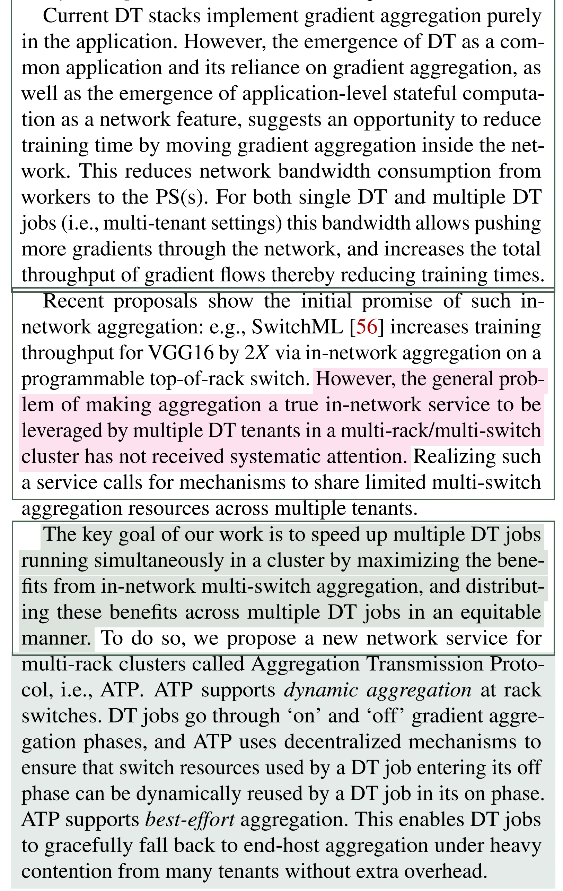

<aside class="atp-notes">

01 /引言起手式与问题定位

（背景切入）<strong>先说明INC（在网计算）的重要性</strong>：将梯度聚合下推到网络内部，核心收益是减少`bandwidth consumption from workers to PS(s)`，从而推高梯度流总吞吐、缩短分布式训练时间。

↓

（SOTA边界）<strong>再用现有工作SwitchML认可INC的价值，进而限定尚未覆盖的场景</strong>：重点指出当前SOTA还没解决的问题=>即如何*making aggregation a true in-network service to be leveraged by multiple DT tenants in a multi-rack/multi-switch cluster*。

↓

（个人批注）<strong>关于“In-Network Service”的拔高立意</strong>：ATP其实只有前两章提到了*in-network service*的contribution，在实现部分并没有展开说明其端网协同如何进一步作为集群级服务向上支撑多应用，因此这里本质上是一种拔高立意的写作技巧（个人拙见）。

↓

（核心主题句）<strong>顺势一句话引入全文主题（非常值得学习的写法）</strong>：起手句是<u>*The key goal of our work is to speed up multiple DT jobs running simultaneously in a cluster by maximizing the benefits from in-network multi-switch aggregation, and distributing these benefits across multiple DT jobs in an equitable manner.*</u> => <strong>一句话同时交代了最核心的贡献+应用场景</strong>。

↓

（系统特性）<strong>最后概括介绍ATP的三项features</strong>：提出`a) dynamic aggregation`、`b) decentralized mechanisms`、`c) best-effort` =>比较特别的是论文正文后续并没有严格围绕这三个feature词逐一展开，更像是作者在引言层给出的概括定义。

</aside>

### 2.2引言结尾的分段式贡献阐述

📄原PDF出处：PDF p.3左栏· §1 Introduction贡献总结<a href="https://www.usenix.org/system/files/nsdi21-lao.pdf#page=3" target="_blank" rel="noreferrer">PDF p.3 · p.742 ↗</a>

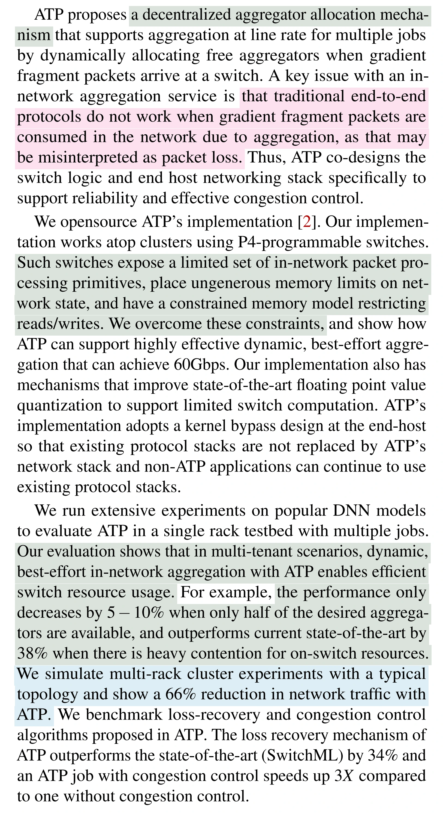

<aside class="atp-notes">

02 /不必拘泥于贡献列表：采用层层递进的分段阐述

（写作借鉴）<strong>不必拘泥于bullet list</strong>：系统论文常采用列表形式罗列贡献，但ATP没有用列表，而是采用<strong>三段自然递进</strong>的形式把“问题→实现突破→实验结论”串成完整叙事。

↓

（核心问题）<strong>回答ATP解决的核心问题是什么</strong>：梯度包在网络中被聚合、被吸收后，<strong>原有端到端协议会把这些正常事件误判为丢包</strong>（*misinterpreted as packet loss*） =>于是ATP提出共同设计`switch logic`和`end-host networking stack`（思路引导非常自然：在网计算需要switch，但等待聚合的过程会被传统端到端协议理解成丢包，因此设计出end-host逻辑，构成<strong>端网协同系统</strong>）。

↓

（实现）<strong>交代ATP的实现克服了什么困难</strong>：直接阐明作者为了实现ATP克服了可编程交换机的哪些现有限制：`limited primitives`、`ungenerous memory limits`、`restricting reads/writes`以及浮点量化计算（`floating point quantization`）；并且说明端侧采用kernel bypass设计，不会影响传统网络栈对非ATP应用的服务。

↓

（性能增益）<strong>给出ATP的实验结论与量化收益</strong>：50%聚合器预算下性能仅降`5–10%`、重度争用下优于SOTA `38%`、多机架仿真减少`66%`网络流量、丢包恢复优于SwitchML `34%`、开启CC带来`3×`加速。

</aside>

### 2.3 Figure 3：从观察实验引出Motivation与端网协同

📄原PDF出处：PDF p.4右上· Figure 3 (单Worker–PS的VGG16通信时序)<a href="https://www.usenix.org/system/files/nsdi21-lao.pdf#page=4" target="_blank" rel="noreferrer">PDF p.4 · Fig.3 ↗</a>

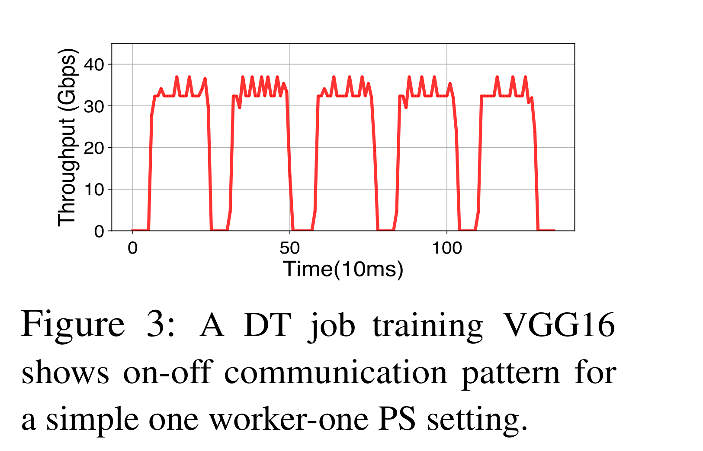

📄原PDF出处：PDF p.4左栏· §2.2 In-Network Aggregation as a Service<a href="https://www.usenix.org/system/files/nsdi21-lao.pdf#page=4" target="_blank" rel="noreferrer">PDF p.4 · §2.2 ↗</a>

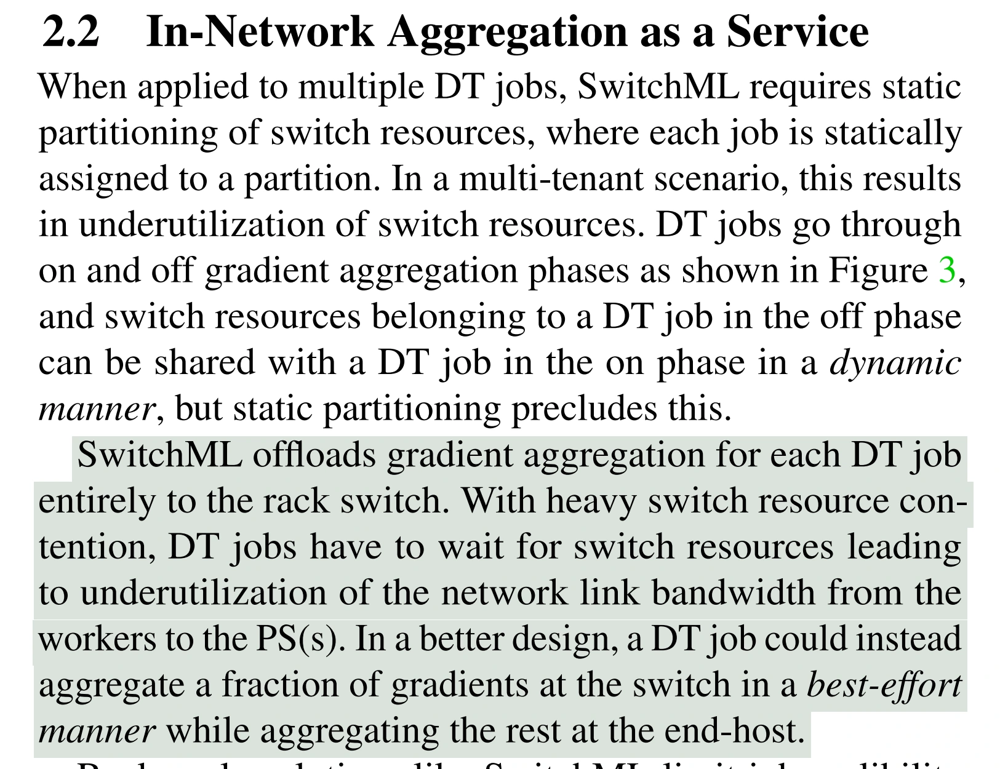

📄原PDF出处：PDF p.4右栏· §2.2 Rethinking Reliability &amp; Congestion-Control<a href="https://www.usenix.org/system/files/nsdi21-lao.pdf#page=4" target="_blank" rel="noreferrer">PDF p.4 · §2.2 ↗</a>

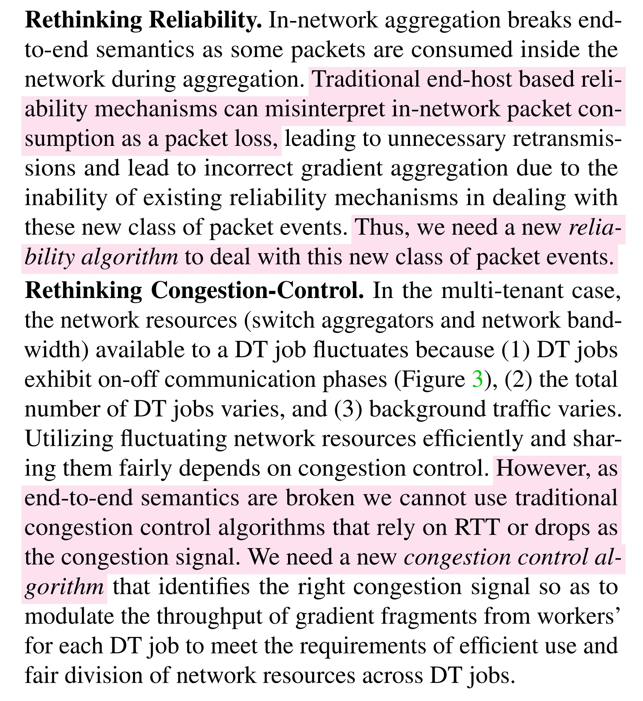

<aside class="atp-notes">

03 /观察实验的引导与端网协同立意

（引出动机）<strong>ATP同样通过一个观察实验（Figure 3）来引出系统Motivation</strong>。

↓

（直接现象）<strong>图3直接展示的现象</strong>：VGG16通信存在明显的`on/off`阶段交替，而不是始终以恒定速率发数据=> <u>通信和计算的交织特性使得动态支持多租户存在机会，交换机的通信与聚合资源并不会每时每刻都在进行服务</u>。

↓

（作者推论）<strong>作者由此提出的观察结论</strong>：Job A不通信（off phase）时，其预留资源本可被正在通信（on phase）的Job B动态使用；静态分区阻止了这种复用，且在资源争用时死等交换机槽位会浪费链路带宽=>因此提出<strong>best-effort在网聚合+端侧PS回退</strong>。

↓

（个人批注）<strong>区分“间接现象”与“直接证据”</strong>：我认为单任务存在on/off是非常符合直觉的<strong>间接现象</strong>，而不是一种可以直接推论出多租户收益的直接证据（虽然这部分的逻辑符合直觉，但从“观察到单任务通信波动”到“推断存在跨任务复用机会”，再到“受控实验验证性能收益”，中间仍隔着一层推论）。

↓

（Motivation升级）<strong>In-Network Aggregation as a Service</strong>：顺着引导出的motivation，接着从端网协同的角度考虑了`Reliability`和`Congestion-Control`。这里确实构成了In-Network Aggregation as a service的基本框架，但作为一个真正的集群service仍有很多隔离与调度问题需要考虑；全文主要在这里引导出思路，后续重点并不在service抽象本身。

</aside>

## 3. Design：按照协议责任边界组织系统

> <strong>本节核心逻辑链</strong>：`正常路径 Switch 聚合 + 碰撞忙槽旁路回退 PS（Fig. 4）` → `16B 包头元数据与聚合槽状态对齐（Fig. 5–6）` → `Switch 单包动作（Fig. 7）+ End-Host 恢复闭环（§3.5–3.7）`

### 3.1系统整体运行路径与端网协议闭环

📄原PDF出处：PDF p.5顶部· Figure 4 (§3.1 System Overview)<a href="https://www.usenix.org/system/files/nsdi21-lao.pdf#page=5" target="_blank" rel="noreferrer">PDF p.5 · Fig.4 ↗</a>

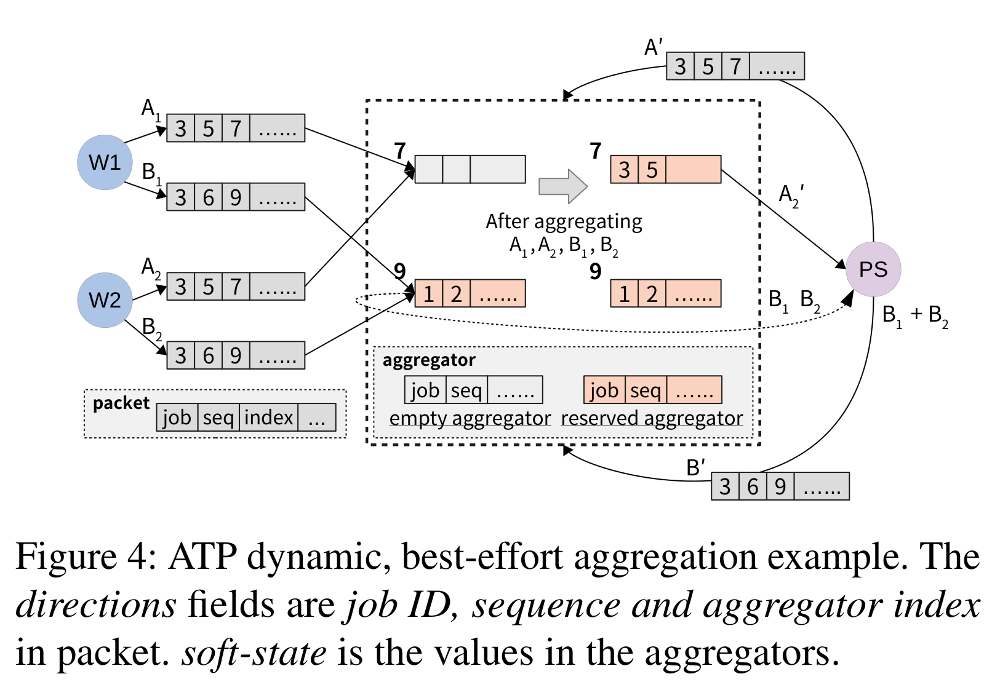

📄原PDF出处：PDF p.7左上· Figure 7 (理想情况下的交换机聚合逻辑流程图)<a href="https://www.usenix.org/system/files/nsdi21-lao.pdf#page=7" target="_blank" rel="noreferrer">PDF p.7 · Fig.7 ↗</a>

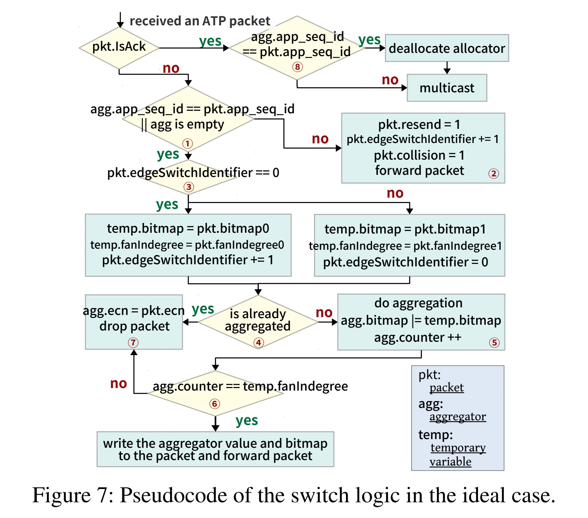

📄原PDF出处：PDF p.7右栏– p.8左栏· §3.5 Switch Logic / §3.6 Host Logic / §3.7 Reliability<a href="https://www.usenix.org/system/files/nsdi21-lao.pdf#page=7" target="_blank" rel="noreferrer">PDF p.7–8 · §3.5–3.7 ↗</a>

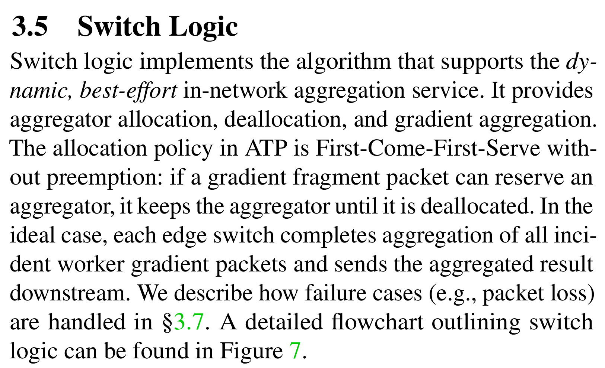

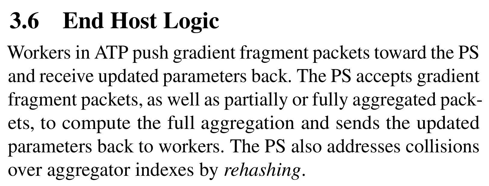

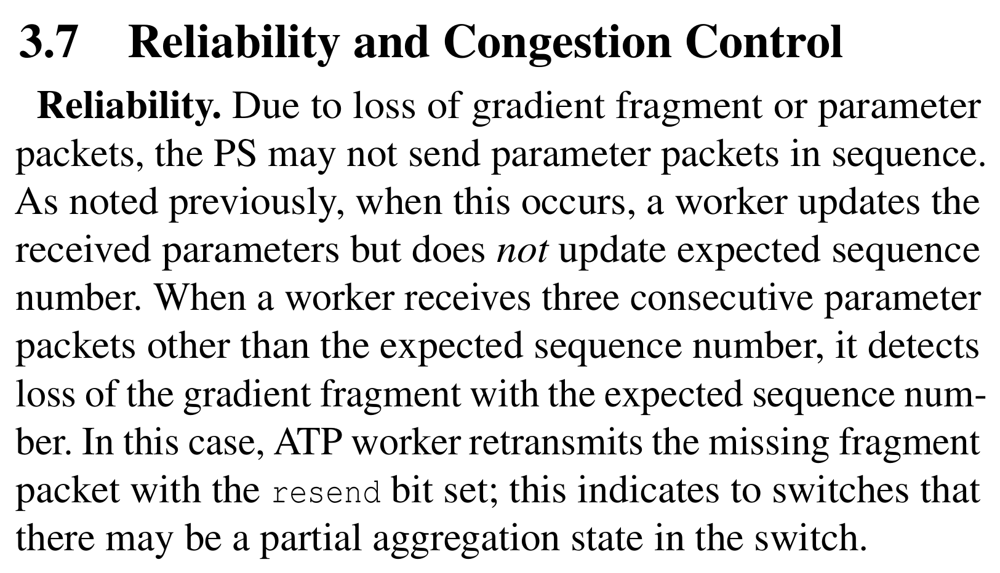

<aside class="atp-notes">

04 /系统整体设计：先看完整执行，再拆两端责任

（核心路径）<strong>直接告知系统的基本思路=>正常情况switch执行+异常情况再送往PS进行处理</strong>：Figure 4先让读者看懂一个最小案例：A片段命中空槽，在交换机内合并；B片段命中忙槽，直接继续送往PS。两种路径最终都由PS返回结果。

↓

（PS的角色）<strong>PS不是异常时才出现的组件</strong>：即便交换机完成了全部SUM，聚合结果仍要送到PS；由PS保存最终结果并负责广播参数ACK来释放交换机槽位。Overview先展示“与原系统相比执行方式怎样改变”，再进入寄存器与位图细节。

↓

（写作借鉴）<strong>图7的“一图言之”表达形式</strong>：对于交换机内包含槽位分配、碰撞旁路、一级/二级位图切换、查重累加、计数判断与ACK释放的复杂流程，作者用Figure 7一张伪代码流程图完整呈现，描述复杂状态机时非常值得参考这种“一图言之”的形式。

↓

（协议闭环）<strong>为什么分别写Switch Logic、End Host Logic与Reliability/CC？</strong>

- <strong>Switch Logic回答局部动作</strong>：单包到来时检查哪个slot、是否碰撞、是否重复、是否凑齐聚合；
- <strong>End Host Logic回答端到端完成</strong>：Worker如何发送与重传，PS如何接收原始或部分聚合结果并反馈新索引；
- <strong>Reliability / CC解释异常与资源压力</strong>：构成“<strong>本地执行→跨节点协作→异常下继续完成</strong>”的完整闭环。

原文把交换机状态称为soft-state，但这不等于系统无状态，也不等于丢失后无成本。它的恢复依赖Worker和PS的协议配合。

</aside>

### 3.2 Figure 5–6：包头携带方向，交换机保存进度

📄原PDF出处：PDF p.6顶部· Figure 5 (ATP 16-Byte包头格式)<a href="https://www.usenix.org/system/files/nsdi21-lao.pdf#page=6" target="_blank" rel="noreferrer">PDF p.6 · Fig.5 ↗</a>

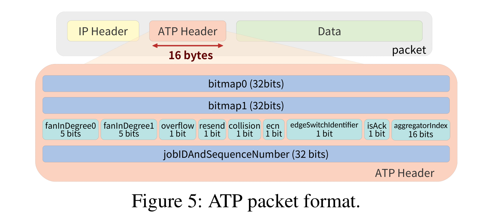

📄原PDF出处：PDF p.6右栏· Figure 6 (交换机Aggregator内存布局)<a href="https://www.usenix.org/system/files/nsdi21-lao.pdf#page=6" target="_blank" rel="noreferrer">PDF p.6 · Fig.6 ↗</a>

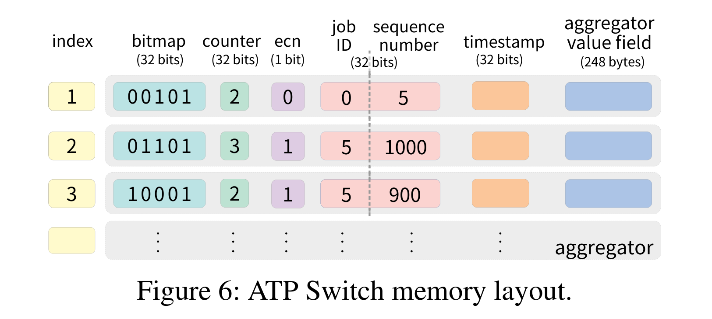

<aside class="atp-notes">

05 /包头四类信息与交换机聚合槽状态

（包头设计）<strong>Figure 5（16-Byte ATP Header）携带的四类信息</strong>：

- <strong>是谁</strong>：`jobIDAndSequenceNumber`区分作业与梯度片段；
- <strong>去哪里</strong>：`aggregatorIndex`指向交换机中的聚合槽；
- <strong>该等谁</strong>：两组`bitmap0/1`与`fanInDegree0/1`分别表达两级聚合成员，`edgeSwitchIdentifier`选择当前聚合层；
- <strong>发生了什么</strong>：`collision`、`resend`、`ECN`、`overflow`与`isAck`标志表达控制事件。

↓

（slot状态）<strong>Figure 6将包头方向与交换机本地状态接起来</strong>：`value`保存部分和，`bitmap / counter`跟踪已到达贡献，`identifier`区分作业片段，`timestamp`记录最近一次聚合更新。

↓

（物理边界）<strong>动态分配的是槽的使用权，系统规模同时受元数据位宽限制</strong>：物理register池在交换机启动时固定建立，后续Job动态占用和复用固定槽位；同时由于单层寄存器仅支持`32-bit`值，两级one-hot位图的编码上限为`32 × 32 = 1024`台主机（`n-bit`对应`n²` Workers）。

注意：`bitmap0`的一位表示本机架组内Worker；`bitmap1`的一位表示第二级的远端机架输入组或本地Worker，两者不是两个“全局Worker位图”。

</aside>

## 4. Placement：跨机架两级聚合（RSS vs. ATP）

> <strong>本节核心逻辑链</strong>：`单机架聚合（RSS）仍向 PS 发送多份结果` → `核心网 ECMP 动态路由耦合代价过高` → `Worker ToR（一级）+ PS ToR（二级）必经点聚合` → `PS 侧接收流量缩减 66%（Fig. 9）`

📄原PDF出处：PDF p.6右下– p.7左栏· §3.4 Inter-rack Aggregation<a href="https://www.usenix.org/system/files/nsdi21-lao.pdf#page=6" target="_blank" rel="noreferrer">PDF p.6–7 · §3.4 ↗</a>

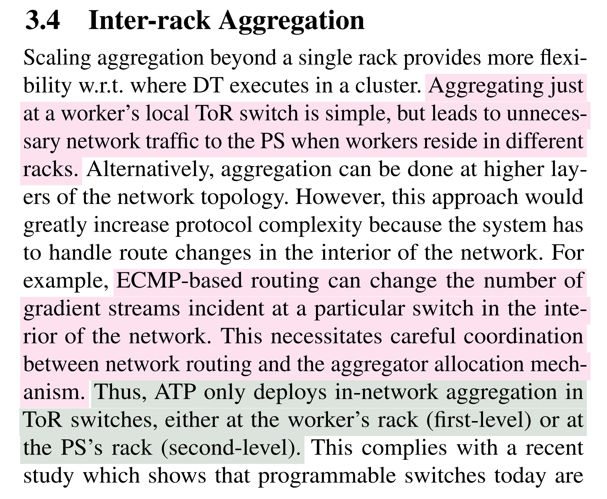

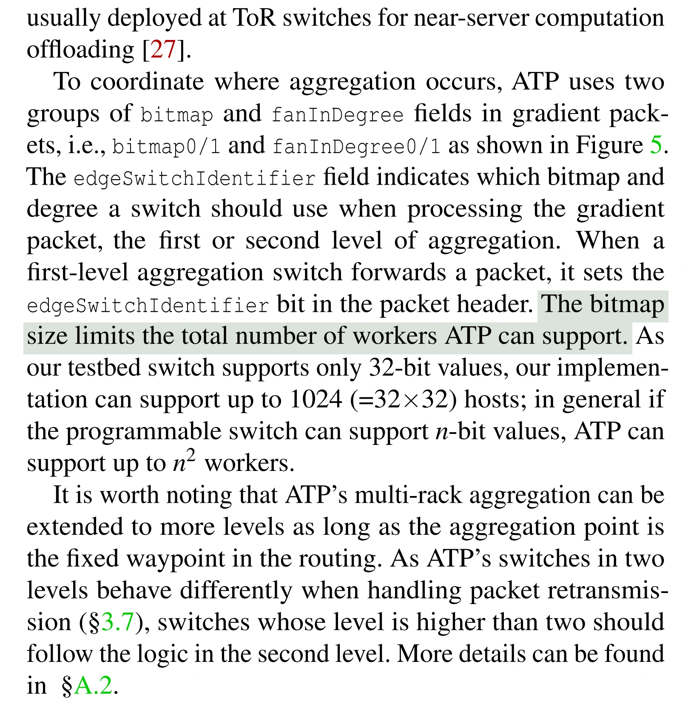

📐逻辑对比重绘图：Rack-Scale Solution (RSS) vs. ATP Inter-rack Aggregation对应§3.4 &amp; §5.2.2

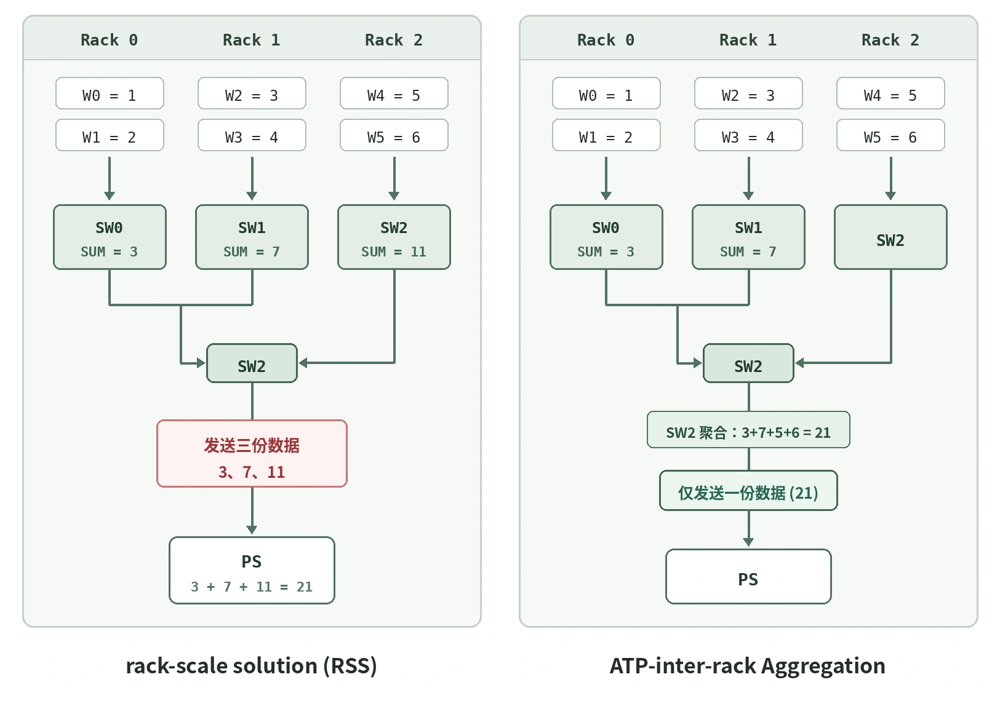

📄原PDF出处：PDF p.11右栏– p.12左上· §5.2.2 Inter-rack Performance &amp; Figure 9<a href="https://www.usenix.org/system/files/nsdi21-lao.pdf#page=11" target="_blank" rel="noreferrer">PDF p.11–12 · Fig.9 ↗</a>

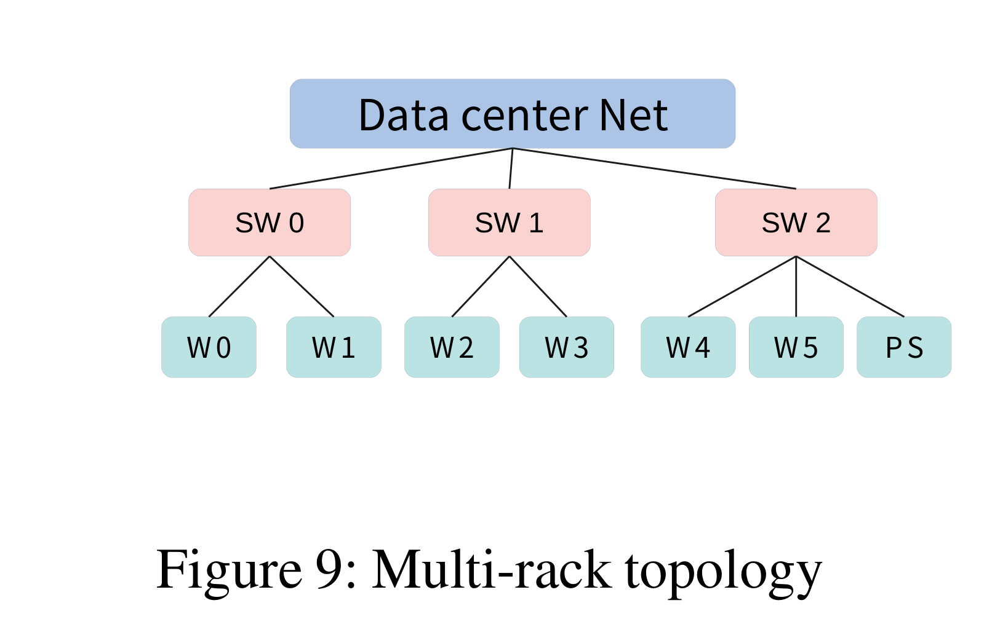

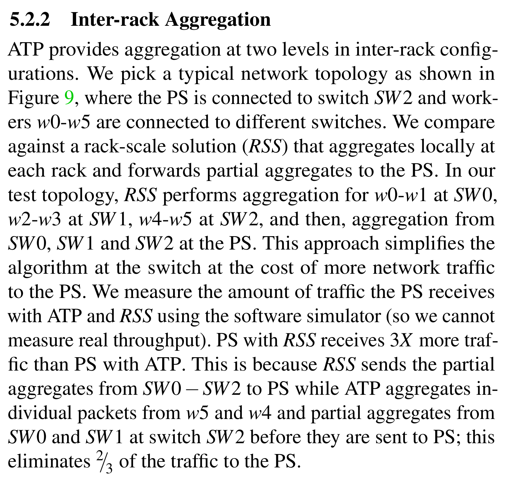

<aside class="atp-notes">

06 /跨机架两级聚合（Inter-rack Aggregation）对比单机架方案（RSS）

（核心概念区分）<strong>Inter-rack Aggregation vs. Rack-Scale Solution (RSS)</strong>：ATP在这里专门区分了跨机架聚合与单机架方案（RSS） =>这种Inter-rack Aggregation是指<strong>在PS所处的机架ToR交换机（SW2）上再进行一次二级聚合</strong>，从而减少需要将非最终聚合数据传输给PS的份数，避免数据搬运造成的带宽浪费。

↓

（RSS的问题）<strong>只做本地ToR聚合（左图RSS）的代价</strong>：Rack 0（`W0=1, W1=2`）在`SW0`算出`SUM=3`，Rack 1（`W2=3, W3=4`）在`SW1`算出`SUM=7`，Rack 2（`W4=5, W5=6`）在`SW2`算出`SUM=11` =>三份partial结果仍分别穿过`SW2`进入PS（<strong>发送三份数据3、7、11</strong>），在`SW2 → PS`最后一跳产生`3×`流量。

↓

（核心网权衡）<strong>为什么不把聚合上移到Spine核心交换机？</strong> =>网络内部的ECMP等动态路由变化会改变某台中间交换机实际看到哪些梯度流（无法天然确定自己的fan-in），迫使路由与聚合槽分配深度协同，极大增加协议复杂度。
(md修改：这里需要解释或者画图说明一下什么是spine核心交换机)

↓

（ATP两级设计）<strong>Worker ToR做第一级+ PS ToR做第二级（右图ATP）</strong> =>远端`SW0 (SUM=3)`和`SW1 (SUM=7)`的结果到达必经点`SW2`后，与本机架`W4=5, W5=6`在`SW2`内直接合并为`3+7+5+6 = 21`，<strong>仅向PS发送一份数据（21）</strong>。

↓

（实验闭环）<strong>设计点、对照与指标直接相连（§5.2.2 Figure 9）</strong> => “为什么增加第二级聚合”对应“只做本地聚合的RSS基线”，再对应“PS接收流量减少66%（由三份变一份）”。

这项跨机架实验使用Tofino软件模拟器（因实验室只有一台物理Tofino交换机）。原文明确说明模拟器不能测真实吞吐；3×指PS接收流量之比，不能转写成训练速度提高3×。

</aside>

## 5. Reliability：让不完整的聚合安全退出

> <strong>本节核心逻辑链</strong>：`早到分片碰撞直达 PS + 晚到分片留守交换机引发停滞` → `端侧超时重传解当前停滞 + PS Rehash 改未来映射` → `一级细粒度 Bitmap 发 Partial / 二级粗粒度 1-bit 透传 PS（Fig. 17）` → `Timestamp 访问驱动回收`

📄原PDF出处：PDF p.8左右栏· §3.6 End Host Logic (碰撞停滞与Rehash反馈)<a href="https://www.usenix.org/system/files/nsdi21-lao.pdf#page=8" target="_blank" rel="noreferrer">PDF p.8 · §3.6 ↗</a>

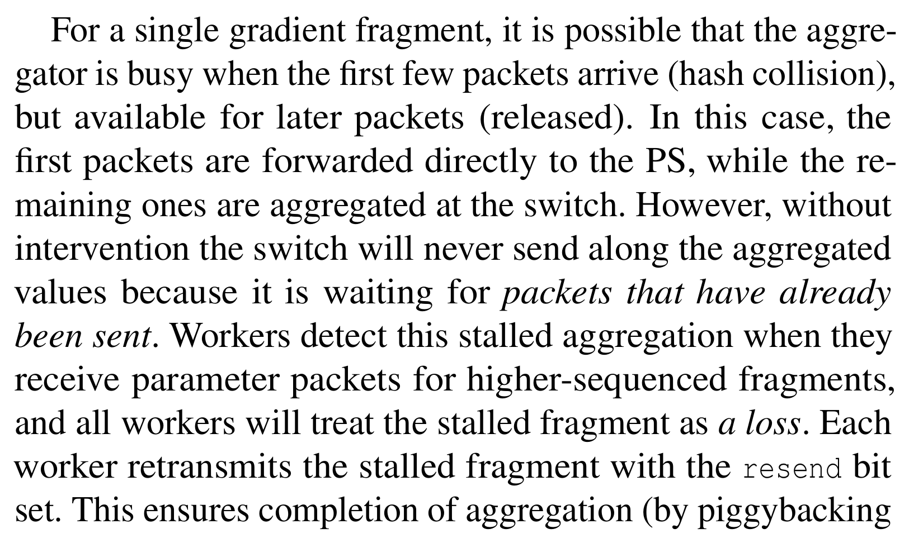

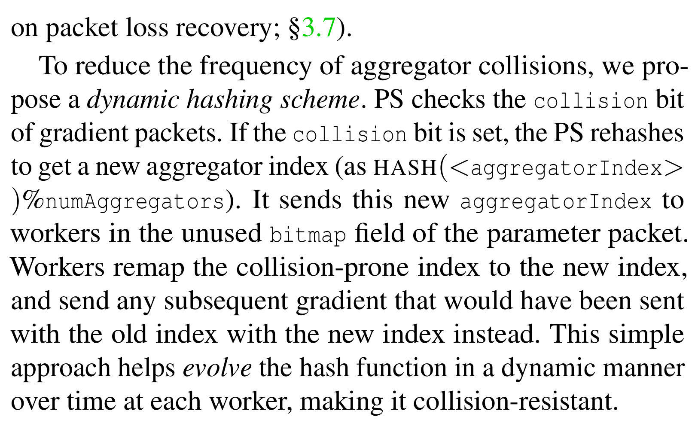

📄原PDF出处：PDF p.9左栏&amp; p.19 · §3.7 Packet Retransmission &amp; Figure 17<a href="https://www.usenix.org/system/files/nsdi21-lao.pdf#page=9" target="_blank" rel="noreferrer">PDF p.9 / p.19 ↗</a>

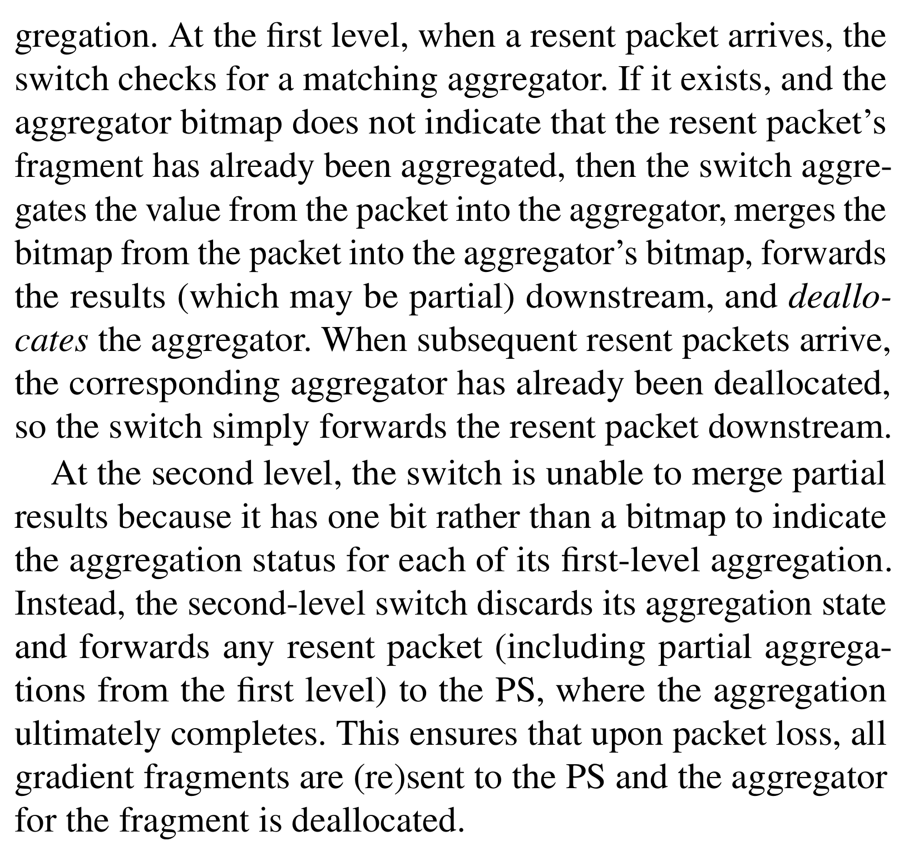

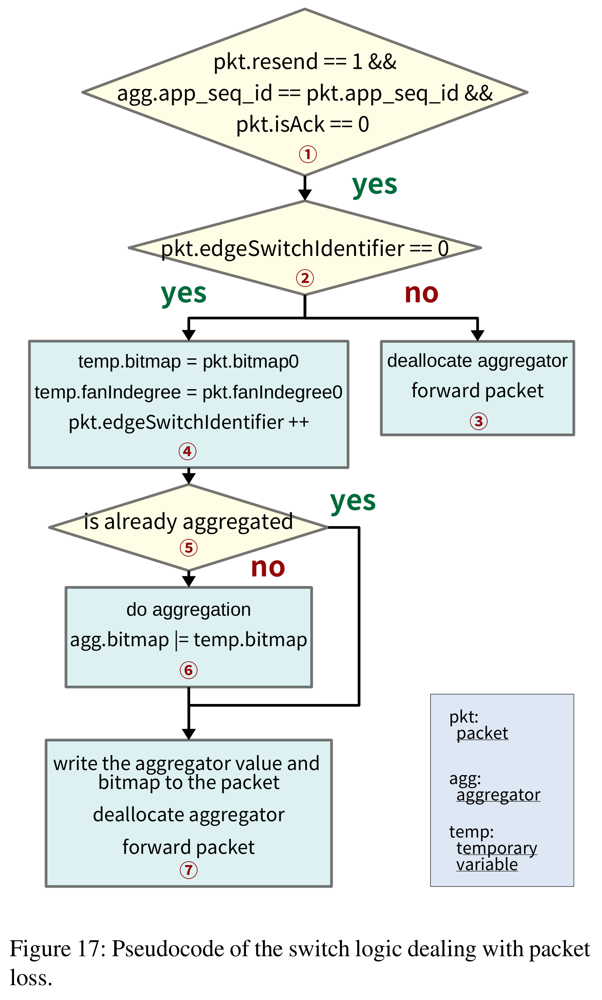

📄原PDF出处：PDF p.9左栏· §3.7 Timestamp超时槽位回收<a href="https://www.usenix.org/system/files/nsdi21-lao.pdf#page=9" target="_blank" rel="noreferrer">PDF p.9 · §3.7 ↗</a>

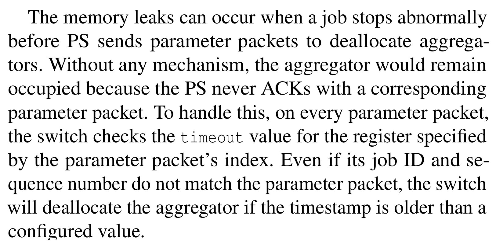

<aside class="atp-notes">

07 /碰撞停滞、两级重传恢复与超时槽位回收

（异常场景）<strong>先写出会卡住的具体情形（Collision Stall）</strong>：早来的`W0/W1`因目标slot忙而打上collision直达PS；晚来的`W2/W3`到达时该slot恰好空闲并留在交换机内聚合=>交换机仍在等凑齐四份贡献，但前两份已经绕过交换机去了PS，形成停滞。

↓

（双重机制）<strong>重传解决当前片段，Rehash改善未来映射</strong>：

- <strong>超时重传（Retransmission）</strong>：将停滞纳入丢包恢复，由端侧超时重发`resend=1`梯度包，最终在PS补齐计算；
- <strong>重哈希（Rehash）</strong>：PS根据collision标志计算并反馈新`aggregatorIndex`，让Worker在后续迭代避开容易冲突的位置。

↓

（两级恢复差异）<strong>两级恢复不同，来自两级状态粒度不同（对应Figure 17）</strong>：

- <strong>第一级（Worker ToR）</strong>：保存组内细粒度Worker `bitmap0`，能判断某个重传贡献是否已计入，因此直接送出已有partial并释放slot（注：附录A.1 Fig. 17补齐了重要分支——即使重传包已被计入，同样会发送已有partial并释放槽位）；
- <strong>第二级（PS ToR）</strong>：对每个第一级机架组只保留`1 bit`，不知道该组内部具体哪些Worker已包含在数值中，因此直接清空放弃该层状态，把重传包透传交给PS。

↓

（槽位回收）<strong>Timestamp的活性用途</strong>：Job异常退出后，PS可能永远不再返回匹配ACK。ATP在处理后续访问该index的报文时，顺便检查对应状态`timestamp`是否超时，以访问驱动的方式回收遗留slot。

Bitmap能发现重叠，但不能拆开已累加的数值（例如<code>sum(W0,W1,W2)</code>不能仅凭bitmap减去W0），因此必须结合PS侧去重与端到端重传共同保证正确性。

</aside>

## 6. Congestion Control：保留聚合过程中的拥塞信号

> <strong>本节核心逻辑链</strong>：`多 Worker 同步等待污染端到端 RTT` → `改用交换机 ECN 并在聚合槽按位 OR 合并保留` → `随 Parameter ACK 广播回全体 Worker 驱动 AIMD 调窗` → `结合 3 个乱序 ACK 协同降速`

📄原PDF出处：PDF p.9左栏底–右栏顶· §3.7 Congestion Control (ECN合并与窗口调节)<a href="https://www.usenix.org/system/files/nsdi21-lao.pdf#page=9" target="_blank" rel="noreferrer">PDF p.9 · §3.7 ↗</a>

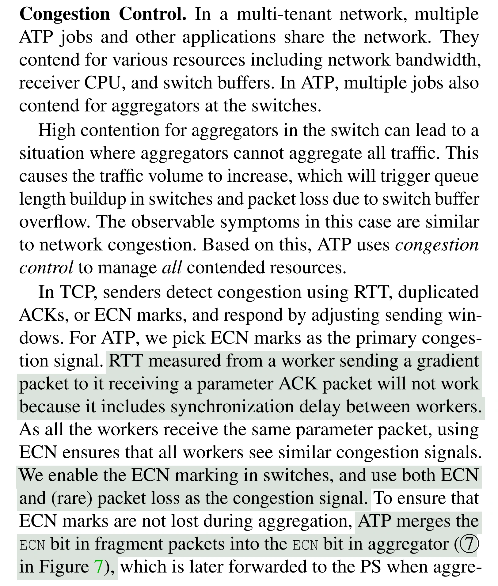

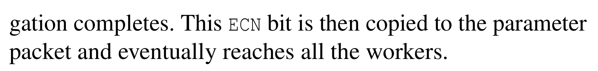

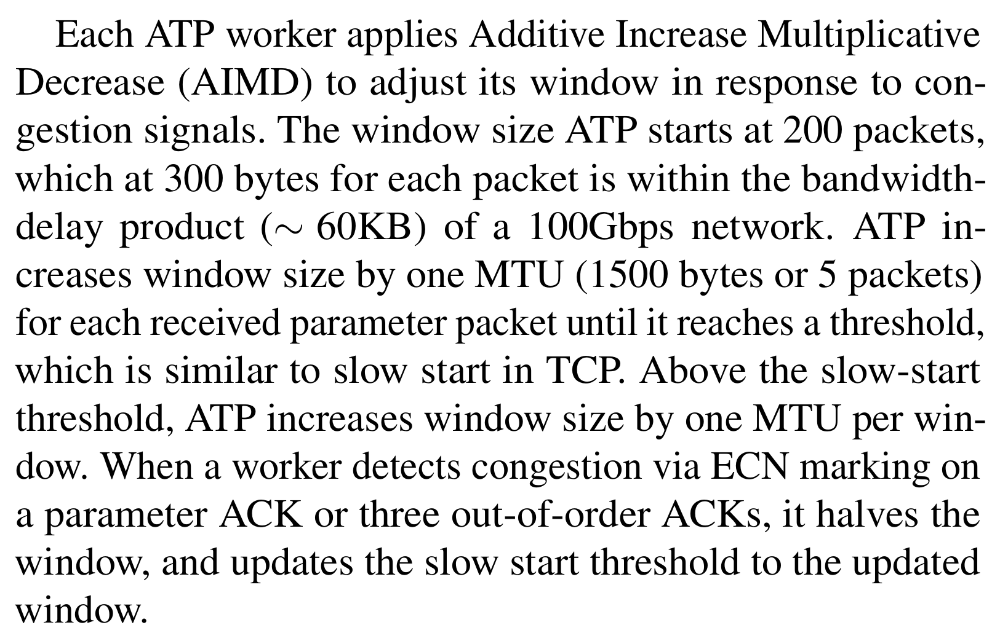

<aside class="atp-notes">

08 /拥塞控制逻辑链：弃用同步污染的RTT，采用ECN按位或合并反馈

（信号选择）<strong>为什么不采用TCP的RTT方式进行控制？</strong> => ATP的拥塞控制没有采用TCP中的RTT，主要是<strong>考虑到了多worker聚合过程中的同步等待延迟</strong>（Worker从发出梯度到收到Parameter ACK还要等待其他Worker的贡献；某个Worker晚发送会让早发送者测得很长RTT，即使网络没有任何拥塞）。

↓

（ECN合并）<strong>采用交换机ECN标识拥塞，且在聚合时不能把标记“吃掉”</strong> =>启用交换机ECN标记作为主拥塞信号；每份到达分片包的ECN位通过按位或（`0 OR 1 OR 0 = 1`）合并进aggregator的ECN位（对应图7步骤⑦），只要任意一个输入分支经历拥塞，聚合输出就保留该标记。

↓

（窗口调节）<strong>aggregator将ECN标记最终传递回全体workers，调节端侧发送窗口size控制速率</strong> =>合并后的ECN随聚合结果到达PS，再复制到广播给所有Worker的Parameter ACK包中，使同一Job的所有Worker看到一致的反馈并调节在途发送窗口（初始窗口`200 packets`，低于阈值每ACK `+1 MTU`，高于阈值每窗口`+1 MTU`，收到ECN则窗口减半并更新阈值）=>解决多租户拥塞问题。

↓

（丢包协同）<strong>结合three out-of-order ACKs协同降速</strong> =>同时说明当端侧收到<strong>three out-of-order ACKs</strong>时，表明链路可能出现了拥塞丢包问题，此时同样触发发送窗口减半、调节发包速率，减轻链路压力。

ECN是collective-level的拥塞通知；乱序ACK参与丢失检测并触发降窗。ECN自身不负责补齐丢失贡献，数据恢复仍由重传协议完成。

</aside>

## 7. Implementation：硬件限制突破与端侧系统优化

> <strong>本节核心逻辑链</strong>：`开篇确立“P4 协议逻辑 + 端侧小包卸载”双主线` → `Two-pass 突破解析上限至 306B` → `利用 Bitmap 置位幂等性完成单次 ALU 读写` → `BytePS 插件 + TSO/MP-QP（省 512× 内存）+ 多线程中心化调度` → `公平 Baseline 与逐项消融（Fig. 19）`

### 7.1第四章主线写法、交换机限制突破与端侧优化组合

📄原PDF出处：PDF p.10左栏· §4 Implementation (Programmable Switch / Two-pass / Control logic)<a href="https://www.usenix.org/system/files/nsdi21-lao.pdf#page=10" target="_blank" rel="noreferrer">PDF p.10左栏· §4 ↗</a>

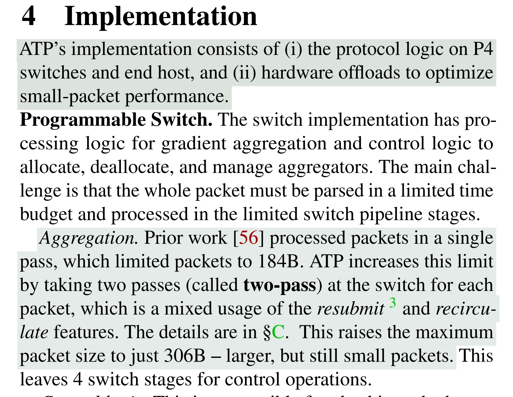

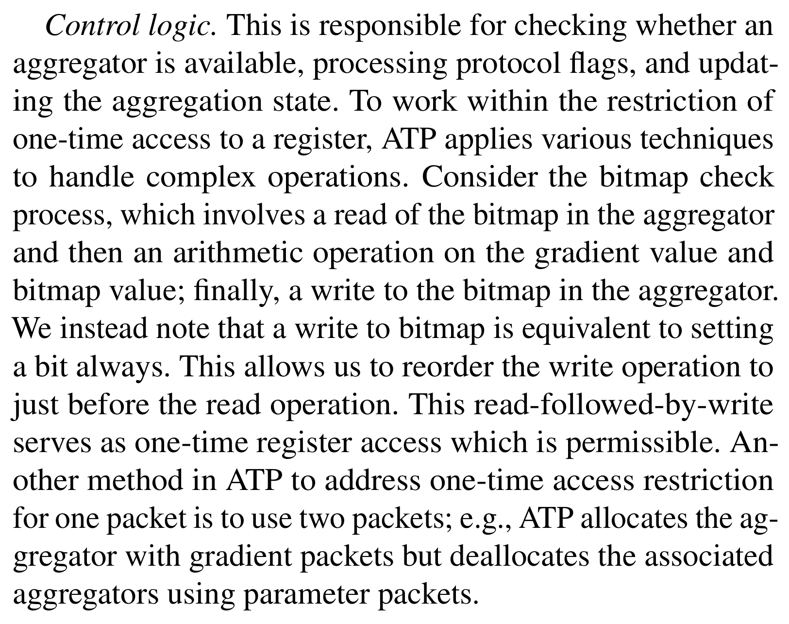

📄原PDF出处：PDF p.10右栏· §4 End-Host Networking Stack &amp; Baseline Implementation<a href="https://www.usenix.org/system/files/nsdi21-lao.pdf#page=10" target="_blank" rel="noreferrer">PDF p.10右栏· §4 ↗</a>

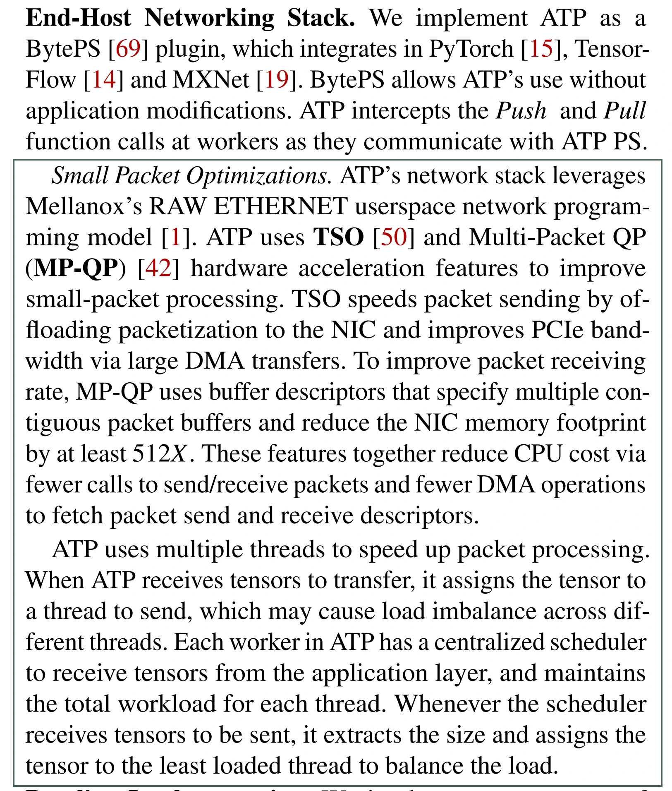

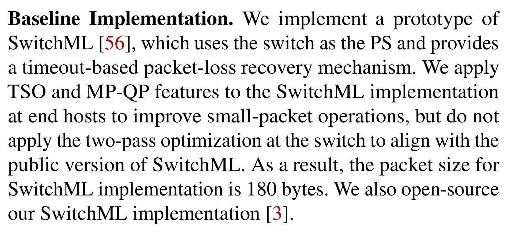

📄原PDF出处：PDF p.21右上· Appendix §D.1 Figure 19 (端侧与交换机优化逐项消融)<a href="https://www.usenix.org/system/files/nsdi21-lao.pdf#page=21" target="_blank" rel="noreferrer">PDF p.21 · Fig.19 ↗</a>

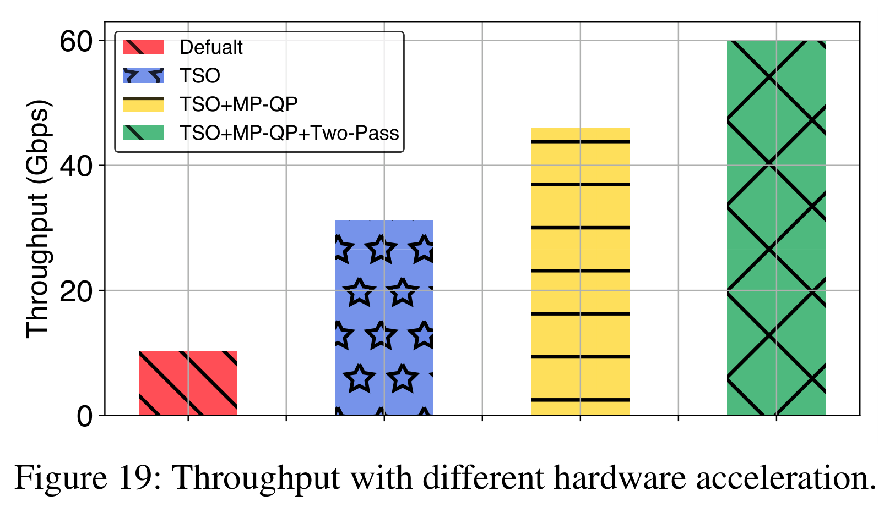

<aside class="atp-notes">

09 /第四章Implementation这一页的写法都值得学习

（(开篇结构)）<strong>第四章Implementation开头值得学习：再一次强调了本工作的组成</strong> =>开篇第一句直接拎出实现的两部分核心：`ATP's implementation consists of (i) the protocol logic on P4 switches and end host, and (ii) hardware offloads to optimize small-packet performance.`

↓

（(交换机实现)）<strong>给出关键实现细节描述，不影响主线阅读但能勾起读者兴趣的细节放到附录</strong>：

- <strong>Two-pass突破解析限制</strong>：前人单次过流水线（single pass）包长受限于`184B`；ATP混用`resubmit`与`recirculate`实现<strong>two-pass</strong>，将最大包长提升至`306B`（留出4个switch stages给控制逻辑），并把流水线排布细节引向附录`§C`；
- <strong>突破单次寄存器访问限制（Control logic）</strong>：利用向bitmap写1的幂等性（`old_bitmap OR packet_bitmap`），在一次stateful ALU操作中把旧bitmap输出到metadata并同时写回置位后的新值，后续读取metadata判断是否重复并决定是否执行SUM（核对作者公开代码[`common.p4`](https://github.com/in-ATP/ATP/blob/main/p4src/includes/common.p4#L27-L35)确认）；同时用梯度包分配槽位、用参数包释放槽位（跨包拆分访问）。

↓

（(协议栈嵌入)）<strong>介绍端侧协议栈的适配和嵌入：这里讲和其他工作如何集成、如何便于用户使用</strong> =>将ATP实现为<strong>BytePS plugin</strong>，无缝接入PyTorch、TensorFlow和MXNet，在Worker与PS通信时拦截`Push`和`Pull`调用，用户无需修改训练应用代码。

↓

（(系统级优化)）<strong>从系统的角度讲了小报文的处理优化，这些确实都是实现细节，适合放到第四章讲解=>同时这里还介绍了网卡对于收发包的作用，以及多线程的作用</strong>：

- <strong>网卡硬件卸载（TSO + MP-QP）</strong>：发送端利用`TSO`将分片卸载至NIC并通过大块DMA提升PCIe带宽；接收端利用`MP-QP`让单个描述符指定多个连续报文缓冲，将NIC内存占用降低至少`512×`，大幅减少收发调用与描述符DMA次数；
- <strong>多线程负载均衡调度器</strong>：为了防止多线程处理报文时负载不均，每个Worker设置一个中心化调度器（centralized scheduler），维护各线程的总负载，收到待发送tensor时提取其大小并分配给当前负载最轻的线程。

↓

（公平对照与消融）<strong>讲清楚Baseline的实现配置，突出对照的公平实现</strong> =>在`Baseline Implementation`中专门交代：复现的SwitchML基线在端侧同样开启了TSO和MP-QP（仅未加交换机two-pass，包长为`180B`）；对于不易实现的baseline，可以在附录说明细节，并通过附录`§D.1`（Figure 19：TSO `3×`、MP-QP `1.47×`、two-pass `1.3×`，总计约`6×`）把工程优化的独立贡献归因清楚。

</aside>

### 7.2 Overflow：浮点量化与饱和溢出回退

📄原PDF出处：PDF p.9右栏– p.10左上· §3.8 Dealing with Floating Point Numbers<a href="https://www.usenix.org/system/files/nsdi21-lao.pdf#page=9" target="_blank" rel="noreferrer">PDF p.9–10 · §3.8 ↗</a>

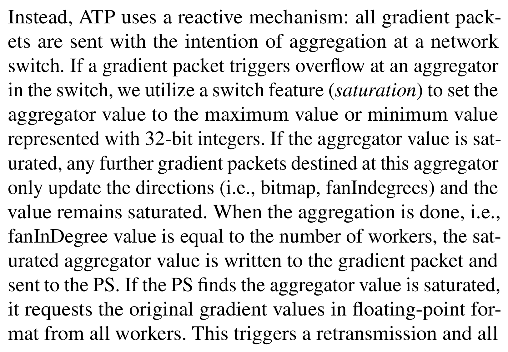

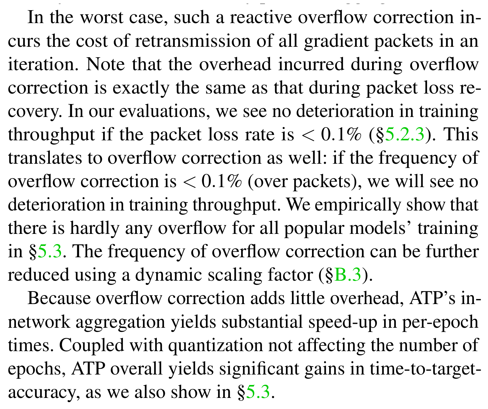

<aside class="atp-notes">

10 /浮点转整数（INT32）与饱和溢出恢复论证链

（数值与控制分离）<strong>数值冻结，但完成状态继续走</strong>：ATP把FP32乘以`10^8`后量化为INT32。一旦累加溢出，交换机用饱和值（saturated value）冻结异常，不再相信该槽数值结果；但<strong>bitmap与完成计数仍继续正常推进</strong>。

↓

（端侧重算）<strong>凑齐后回退端侧浮点求和</strong>：当完成条件达到后，PS收到带`overflow`标志的报文，随即请求该片段的原始FP32梯度，由所有Worker重传并在端侧重新精确求和。

↓

（论证链条）<strong>学论证方式，也看类比边界</strong>：作者先承认最坏情况下要重传整个iteration的梯度→再引用低丢包率（`< 0.1%`）下训练吞吐无退化的实验→最后指出所测主流模型训练中实际overflow频率极低（`< 0.1%`），形成“<strong>异常代价→恢复实验→实际发生频率→应用总体收益</strong>”的完整论证链。

</aside>

## 8. Evaluation：围绕系统设计开展实验与消融验证

> <strong>本节核心逻辑链</strong>：`6 个评估问题导引` → `Metrics / Baselines (BytePS NtoN) / Workloads (VGG16 vs. 4MB Microbenchmark)` → `Dumbbell 双任务 TTA（Fig. 12）` → `PTA 容量标定与 33% 压测（Fig. 13–14）` → `50% 槽位 8-to-1 Incast 下 CC 消融（Fig. 15）` → `非 ATP 背景流 Max-Min 公平共存（Fig. 16 & Fig. 20）`

### 8.1实验章节导引与Metrics / Baselines / Workloads配置

📄原PDF出处：PDF p.10右栏下· §5 Evaluation (6个核心评估问题与章节映射)<a href="https://www.usenix.org/system/files/nsdi21-lao.pdf#page=10" target="_blank" rel="noreferrer">PDF p.10 · §5 ↗</a>

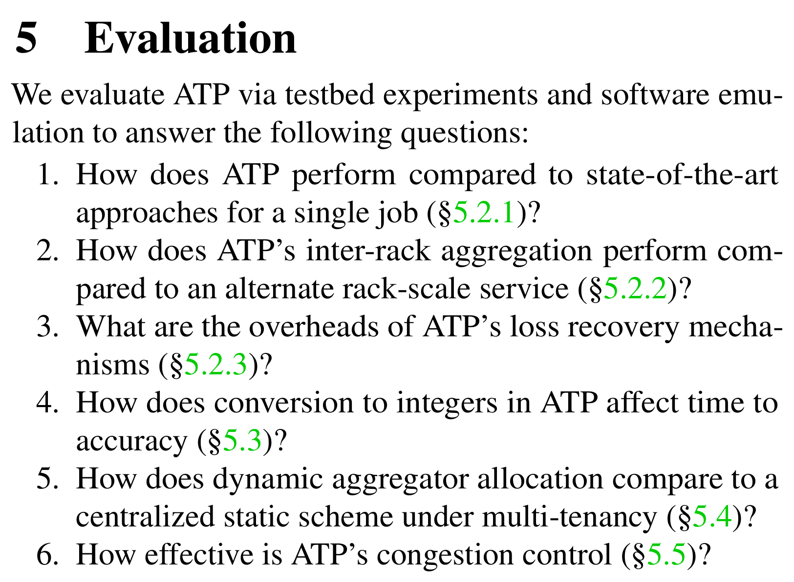

📄原PDF出处：PDF p.11左栏· §5.1 Experimental Setup (Metrics / Baselines / Workloads)<a href="https://www.usenix.org/system/files/nsdi21-lao.pdf#page=11" target="_blank" rel="noreferrer">PDF p.11 · §5.1 ↗</a>

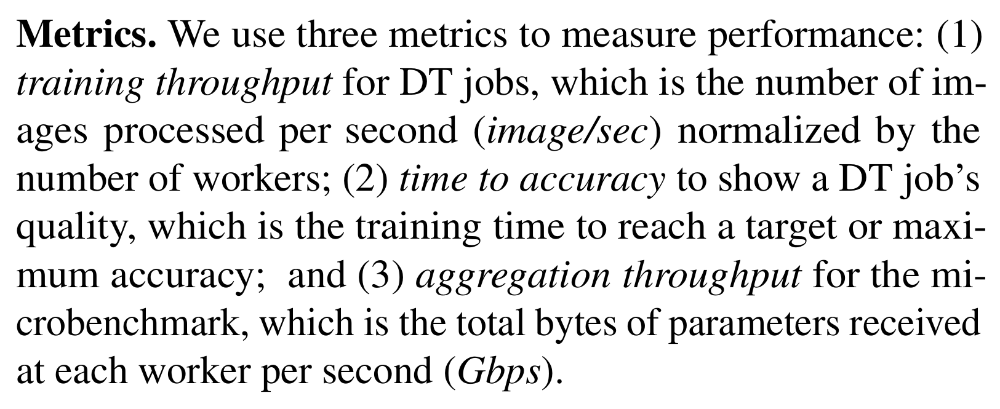

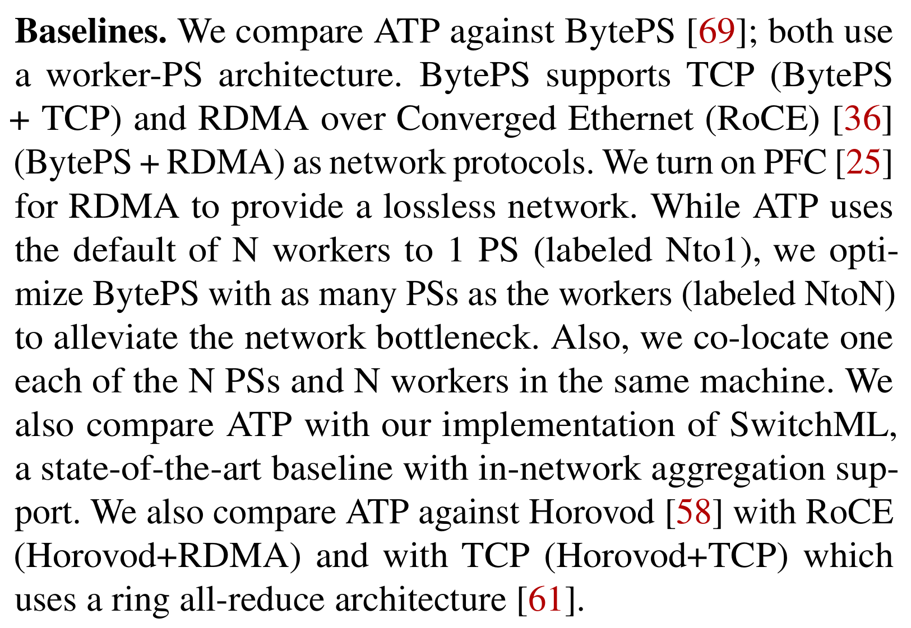

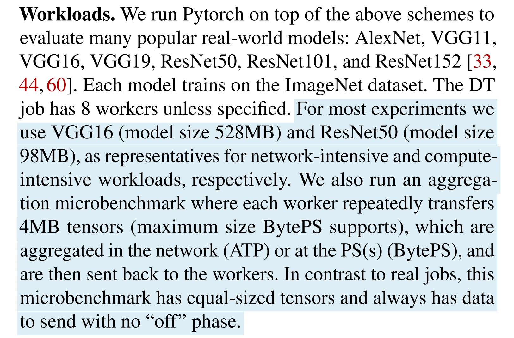

<aside class="atp-notes">

11 / Evaluation展示清晰的实验对比思路+对应章节

（评估主线）<strong>Evaluation开篇通过6个问题展示清晰的实验对比思路+对应的章节</strong>：先列出要回答的6个核心问题（单任务性能`§5.2.1`、跨机架`§5.2.2`、恢复开销`§5.2.3`、量化与精度`§5.3`、多租户动态分配`§5.4`、拥塞控制`§5.5`），让读者在看图前先清楚每一节为什么存在。

↓

（Metric）<strong>三项核心性能指标</strong>：

- <strong>Training throughput</strong>：面向DT任务的训练吞吐（按Worker数归一化的`images/sec`）；
- <strong>Time-to-accuracy (TTA)</strong>：达到目标或最高精度所需的训练时间（证明加速同时不损模型收敛质量）；
- <strong>Aggregation throughput</strong>：面向微基准的聚合吞吐（每个Worker每秒收到的参数总字节数`Gbps`）。

↓

（Baselines）<strong>第五章的Baseline详细说明</strong>：

- <strong>BytePS（TCP / RoCEv2 RDMA）</strong>：同为Worker–PS架构，除默认`Nto1`（单PS）外，还专门优化配置了与Worker数相等的<strong>多PS模式（`NtoN`，将N个PS与N个Worker同机共置）</strong>以消除单PS接收瓶颈；
- <strong>SwitchML</strong>：作者公平复现的单任务在网聚合SOTA基线；
- <strong>Horovod（TCP / RDMA）</strong>：代表Ring All-Reduce架构的主流基线。

↓

（Workloads）<strong>Workload的选择说明</strong>：

- <strong>真实模型</strong>：评估7种主流模型，重点以<strong>VGG16（528MB，代表网络通信密集型）</strong>和<strong>ResNet50（98MB，代表计算密集型）</strong>作为核心代表（默认8 Workers）；
- <strong>合成微基准（Aggregation Microbenchmark）</strong>：每个Worker持续反复传输等大小`4MB` tensor（BytePS支持的最大尺寸），<strong>始终有数据发送、没有任何"off"阶段</strong>，用于剥离计算间隔测试极限持续聚合性能。

</aside>

### 8.2 Figure 12：多任务Dumbbell拓扑下的端到端TTA验证

📄原PDF出处：PDF p.12右栏&amp; p.13右上· §5.3.2 Multi-job TTA &amp; Figure 12<a href="https://www.usenix.org/system/files/nsdi21-lao.pdf#page=12" target="_blank" rel="noreferrer">PDF p.12–13 · Fig.12 ↗</a>

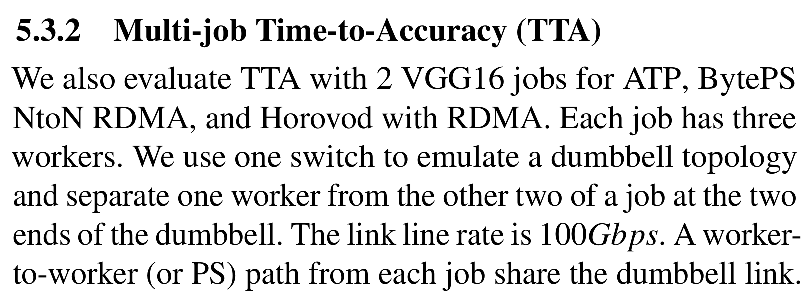

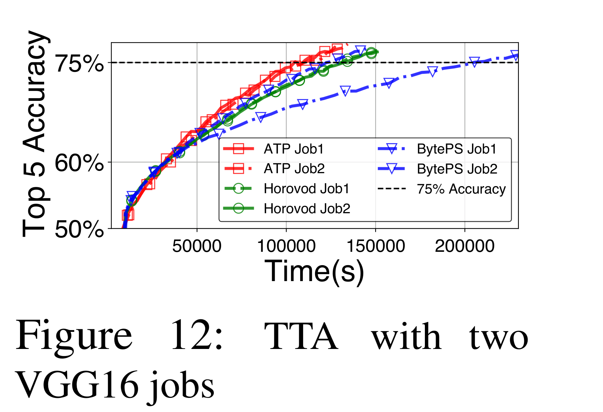

📐逻辑拓扑重绘图：标准Dumbbell瓶颈拓扑vs. ATP单交换机双Job跨侧放置示意对应§5.3.2

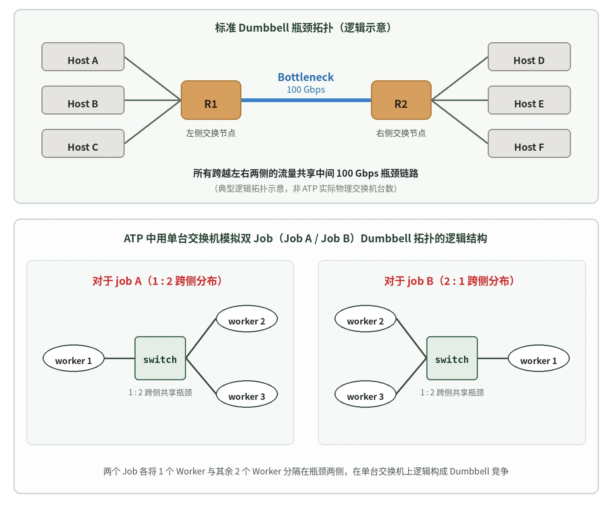

<aside class="atp-notes">

12 /多任务Dumbbell瓶颈模拟与端到端TTA表现

（实验构造）<strong>单台交换机模拟双Job争用100Gbps瓶颈的Dumbbell拓扑</strong>：同时运行2个VGG16任务（每个Job各3个Workers + 1个PS），将每个Job的1个Worker与另外2个Workers分隔在瓶颈两侧，使两个Job的跨侧流量共享一条`100Gbps`链路。

↓

（拓扑理解）<strong>结合逻辑结构图理解单交换机放置（见左下重绘图）</strong>：

- <strong>标准Dumbbell拓扑</strong>：左右各有一台交换节点（`R1`、`R2`），所有跨侧流量共享中间`100Gbps` Bottleneck链路；
- <strong>ATP单交换机下的双Job逻辑结构</strong>：对于<strong>Job A</strong>，`worker 1`在左、`worker 2/3`在右（`1 : 2`跨侧）；对于<strong>Job B</strong>，`worker 2/3`在左、`worker 1`在右（`2 : 1`跨侧），两幅图中的`switch`为同一台物理交换机。

↓

（实验结论）<strong>Figure 12端到端收敛加速</strong>：在双任务共享瓶颈下，ATP的Job 1与Job 2达到`75%` Top-5精度的训练时间（TTA）显著短于BytePS NtoN RDMA与Horovod RDMA。

注：共享同一台物理switch不自动等于共享100G物理链路，具体取决于哪条端口/回环链路由两Job共同经过；Figure 12提供的是端到端TTA证据。

</aside>

### 8.3 Figure 13a & 13b：动态共享vs.静态分区与动态Hash收敛过程

📄原PDF出处：PDF p.12右栏&amp; p.13左上· §5.4.1 Dynamic vs. Static Sharing &amp; Figure 13(a)<a href="https://www.usenix.org/system/files/nsdi21-lao.pdf#page=12" target="_blank" rel="noreferrer">PDF p.12–13 · Fig.13a ↗</a>

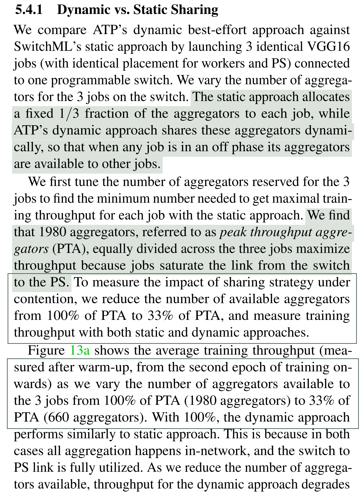

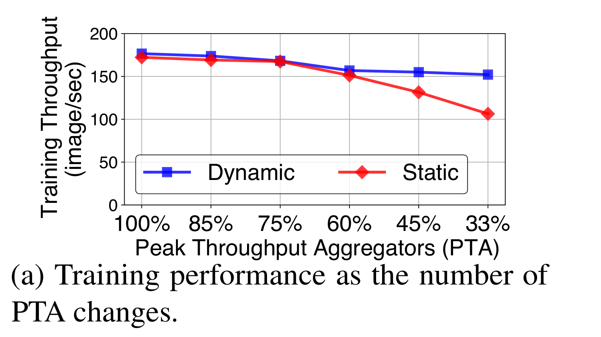

📄原PDF出处：PDF p.13左栏&amp;中上· §5.4.1 Figure 13(b)正文与PS回退聚合频次图<a href="https://www.usenix.org/system/files/nsdi21-lao.pdf#page=13" target="_blank" rel="noreferrer">PDF p.13 · Fig.13b ↗</a>

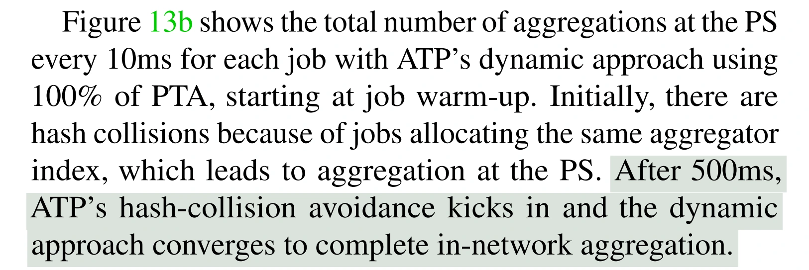

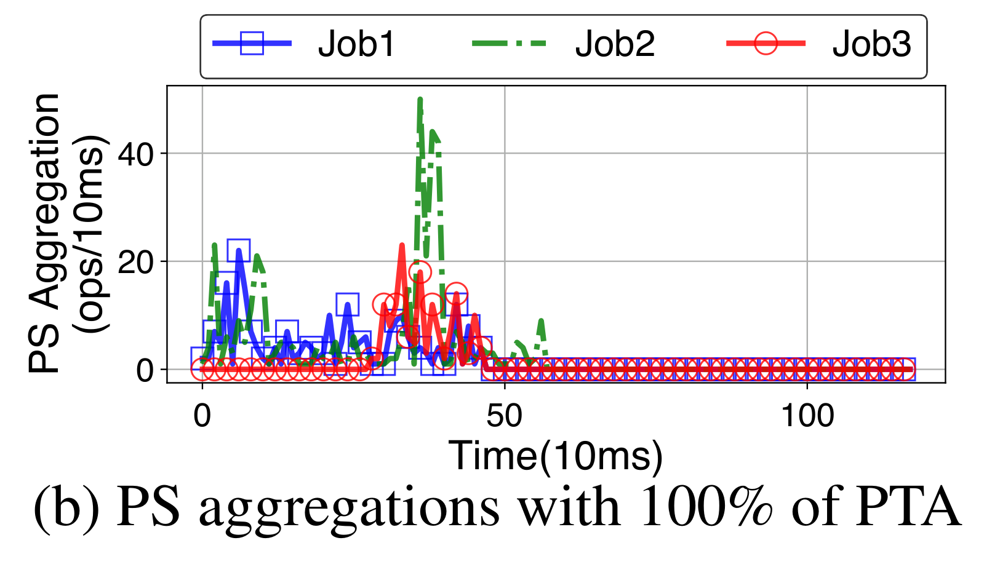

<aside class="atp-notes">

13 / PTA容量标定、33%资源受限测试与动态Hash碰撞收敛

（对比基线）<strong>ATP动态共享vs. SwitchML平均静态分区扩展</strong>：同时启动3个相同的VGG16任务连接至一台交换机；ATP动态共享所有aggregator（任一任务进入off阶段时其槽位可供其他任务借用），而静态方案对SwitchML做平均静态分区扩展（每个任务固定分配`1/3`的aggregators）。

↓

（标定PTA）<strong>先找到让3个job中每个job达到最大训练吞吐的aggregator数量（`100% PTA = 1980`）</strong> =>我认为这应该是对每个job单独调整aggregator的数量进行测试标定（在实际多租户场景下，不同任务所需要的aggregator数量应当不同）。

↓

（物理机理）<strong>为什么aggregator数量能决定最大吞吐？</strong> =>因为<strong>aggregator的数量决定了交换机并发处理报文聚合的程度（在途并发窗口）</strong>，所以调整aggregator的数量可以使得交换机到PS的链路打满带宽。

↓

（33%压测）<strong>将总预算从100% PTA调低到33% PTA（`660`个）</strong> =>这里调整到`33%`应该是为了<strong>制造资源不足的竞争场景，从而体现动态利用的优势</strong>；使用`33%`恰好说明<strong>当前的交换机资源只够1个job打满带宽</strong>，取值比较合理（不过单看Figure 13a这张汇总折线图本身还略显简单）。

↓

（Hash收敛）<strong>Figure 13(b)：展示动态场景下因Hash碰撞回退到PS聚合的频次变化</strong> =>展示了在`100% PTA`下启动时因hash冲突回退到PS聚合的频次，以及随后由<strong>动态hash调整（hash-collision avoidance）</strong>在约`500ms`（横轴刻度50，单位`10ms`）后逐渐降低至0的过程，体现了动态hash重分配的效果。

↓

（读图存疑）<strong>Figure 13(b)未交代清楚的细节</strong>：这里原文没具体介绍该子图对应哪个workload阶段下的多job（初看容易猜测是否只是简单的allreduce-microbenchmark），而且<strong>没介绍这里的多job是同时同步启动还是异步启动，对于横轴`35`（即`350ms`）左右的hash碰撞突发尖峰也没有给出解释</strong>。

</aside>

### 8.4 Figure 13c & Figure 14：资源不足下的动态复用时序与多Job消融实验

📄原PDF出处：PDF p.13左栏&amp;右上· §5.4.1 Figure 13(c)正文与33% PTA在网聚合时序图<a href="https://www.usenix.org/system/files/nsdi21-lao.pdf#page=13" target="_blank" rel="noreferrer">PDF p.13 · Fig.13c ↗</a>

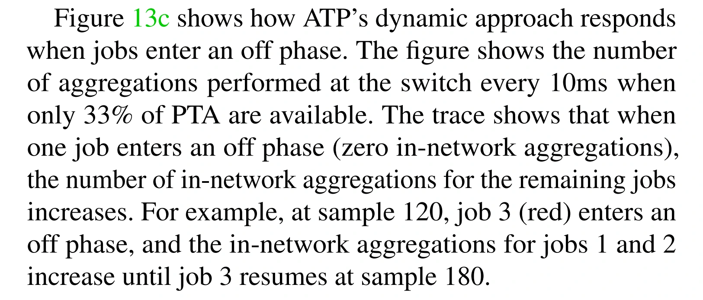

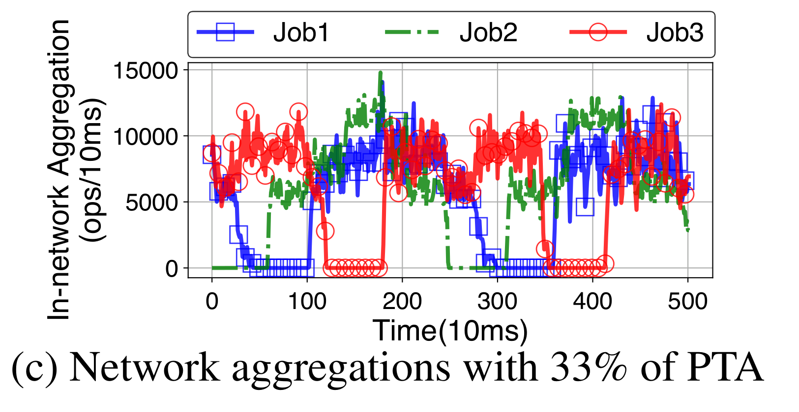

📄原PDF出处：PDF p.13左下–右中· §5.4.2 Effectiveness of ATP's Hashing Scheme &amp; Figure 14<a href="https://www.usenix.org/system/files/nsdi21-lao.pdf#page=13" target="_blank" rel="noreferrer">PDF p.13 · Fig.14 ↗</a>

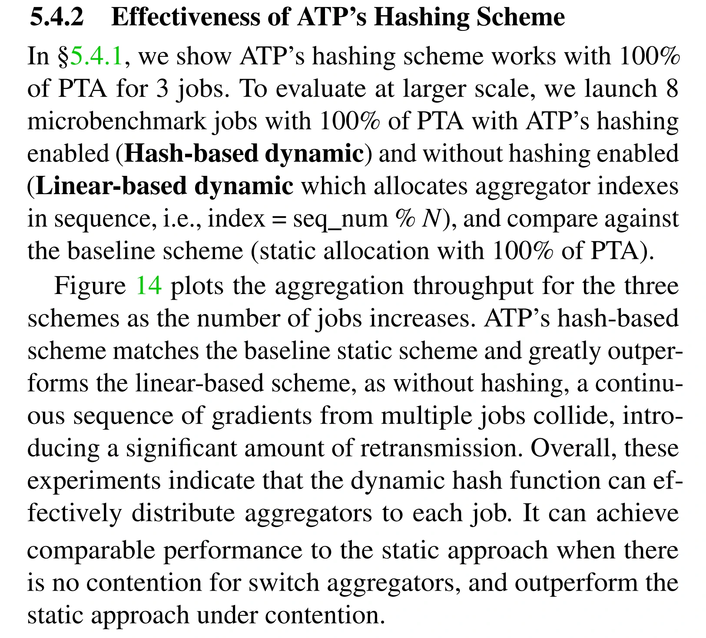

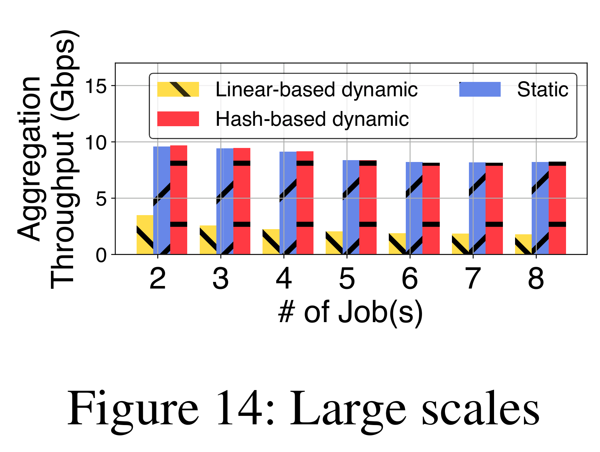

<aside class="atp-notes">

14 / 33% PTA下的动态复用时序（Fig. 13c）与多Job Hash消融（Fig. 14）

（动态性展示）<strong>Figure 13(c)：说明动态场景下资源不足（33% PTA）时每个job的aggregation情况，表达出了“动态性”</strong> =>曲线展示了每`10ms`在交换机内完成的聚合次数：当某一个job进入off phase（在网聚合降为0，例如sample 120处的红色Job 3）时，其余正在通信的Job 1和Job 2在网聚合次数立即上升，直到sample 180处Job 3恢复发送。

↓

（批判思考）<strong>机制有效性与应用/系统服务级性能的边界</strong>：其实相反我倒是感觉Figure 13(a/b/c)这三个动态multi-job的实验数据，并没有很好地体现在<strong>application-level或者完整系统服务（in-network service）</strong>下的复杂多租户性能，更多<strong>只能说明动态共享与重哈希机制本身的有效性</strong>。

↓

（大规模消融）<strong>Figure 14（§5.4.2）：接着做了在更多job（2～8个microbenchmark jobs）情况下的消融对比实验</strong> =>对比`Hash-based dynamic`（开启随机化哈希）、`Linear-based dynamic`（关闭哈希，按`index = seq_num % N`顺序映射）与`Static`静态分区=>验证了若不开启随机化Hash，多作业连续梯度分片会发生严重碰撞并引发大量重传，从而证明动态哈希函数在扩展任务数时的有效性。

</aside>

### 8.5 Figure 15：拥塞控制消融实验（With other ATP traffic）

📄原PDF出处：PDF p.14左栏中· §5.5 With other ATP traffic正文<a href="https://www.usenix.org/system/files/nsdi21-lao.pdf#page=14" target="_blank" rel="noreferrer">PDF p.14 · §5.5 ↗</a>

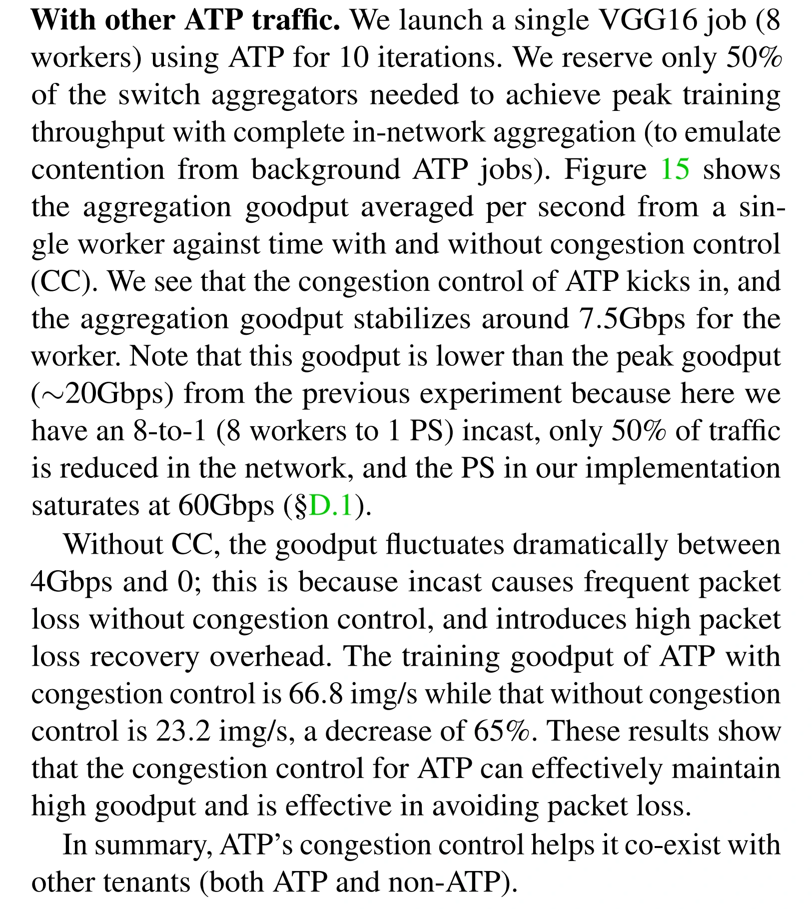

📄原PDF出处：PDF p.13右栏中· Figure 15 (开启与关闭CC的Goodput时序对比)<a href="https://www.usenix.org/system/files/nsdi21-lao.pdf#page=13" target="_blank" rel="noreferrer">PDF p.13 · Fig.15 ↗</a>

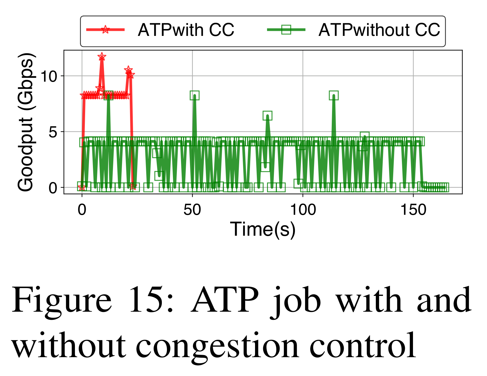

<aside class="atp-notes">

15 /拥塞控制（CC）消融实验：资源受限回退下的Incast抑制

（实验意义）<strong>做了拥塞控制的消融实验，这个实验的意义感觉还不错，对比效果很明显</strong> =>启动单个8-Worker VGG16任务运行10个iterations，仅分配峰值所需聚合器数量的`50%`，以此模拟后台其他ATP任务争用交换机资源。

↓

（Incast成因）<strong>回忆ATP的回退机制：为什么槽位不足会触发Incast？</strong> => ATP是在发生交换机槽位竞争或异常后，将未能聚合的分片直接交给PS进行处理；因此，当50%流量绕过交换机、由多worker（8 Workers）同时直接给到单台PS进行聚合时，就会触发严重的<strong>流量集中（8-to-1 incast）</strong>。

↓

（ATP with CC）<strong>带有CC的表现（红线）与未解释的尖峰疑问</strong> =>在该异常情况下，带有CC的ATP可以在<strong>PS总接收带宽饱和于`60Gbps`（见`§D.1`）</strong>的情况下，让8个worker中的每个worker稳定实现约<strong>`7.5Gbps`</strong>的带宽（训练吞吐达`66.8 img/s`） => <strong>不过原文并没解释红线为何会出现激增，尤其是最后训练完成前的那次尖峰激增</strong>。

↓

（ATP without CC）<strong>不带CC的崩溃表现（绿线）</strong> =>关闭拥塞控制后，incast引发频繁丢包与重传恢复开销：<strong>只有少部分时刻可以成功，大部分时刻聚合一直失败并且处于超时等待状态</strong>（goodput在`4Gbps`与`0`之间剧烈波动，训练吞吐跌至`23.2 img/s`，下降`65%`）。

</aside>

### 8.6 Figure 16 &附录Figure 20：与非ATP背景流量共存及多任务公平性边界

📄原PDF出处：PDF p.13右栏下· §5.5 Effectiveness of Congestion Control &amp; With non-ATP traffic<a href="https://www.usenix.org/system/files/nsdi21-lao.pdf#page=13" target="_blank" rel="noreferrer">PDF p.13 · §5.5 ↗</a>

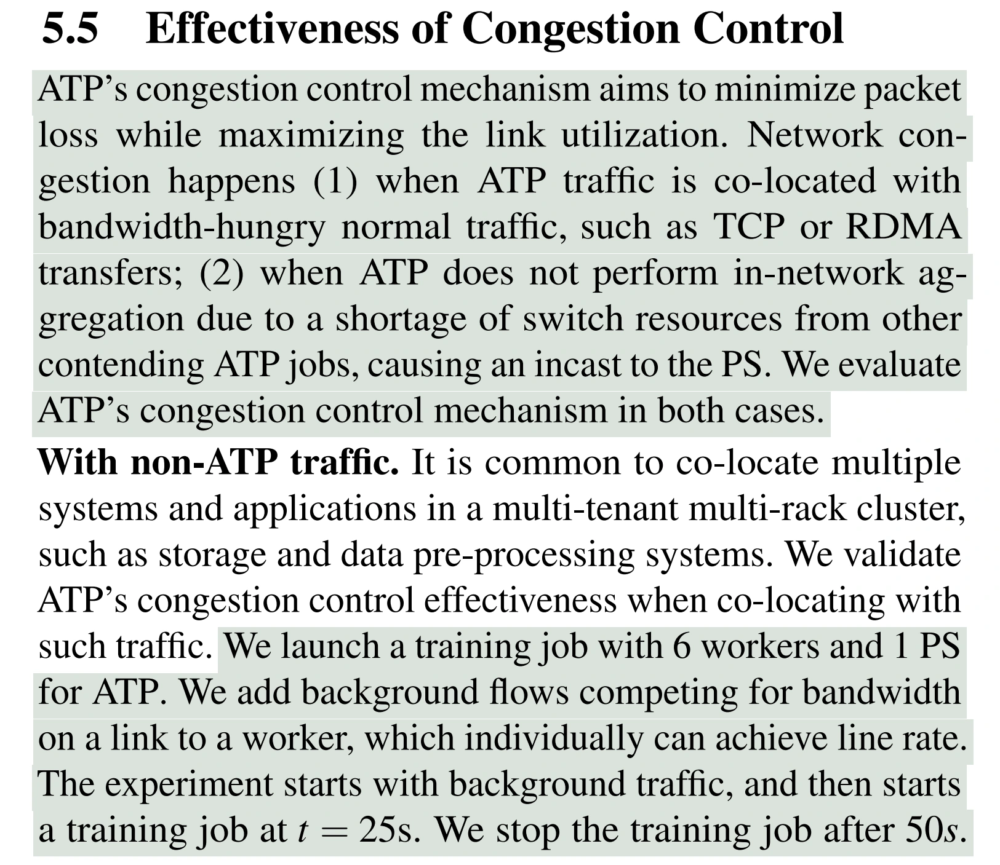

📄原PDF出处：PDF p.14左栏上· Fig. 16a正文<a href="https://www.usenix.org/system/files/nsdi21-lao.pdf#page=14" target="_blank" rel="noreferrer">PDF p.14 ↗</a>

📄原PDF出处：PDF p.14左栏上· Fig. 16b正文<a href="https://www.usenix.org/system/files/nsdi21-lao.pdf#page=14" target="_blank" rel="noreferrer">PDF p.14 ↗</a>

📄原PDF出处：PDF p.13右上· Figure 16(a)<a href="https://www.usenix.org/system/files/nsdi21-lao.pdf#page=13" target="_blank" rel="noreferrer">PDF p.13 ↗</a>

📄原PDF出处：PDF p.13右上· Figure 16(b)<a href="https://www.usenix.org/system/files/nsdi21-lao.pdf#page=13" target="_blank" rel="noreferrer">PDF p.13 ↗</a>

📄原PDF出处：PDF p.22左栏· Appendix §D.2 Figure 20 (异构负载下的共享偏向性)<a href="https://www.usenix.org/system/files/nsdi21-lao.pdf#page=22" target="_blank" rel="noreferrer">PDF p.22 · Fig.20 ↗</a>

<aside class="atp-notes">

16 /背景流量共存测试（Fig. 16a/b）与异构公平性边界（Fig. 20）

（系统完整性）<strong>ATP值得学习的一点：在“设计过程+实验评估过程”都考虑到了拥塞的情况，考虑到了网络协议栈共存的事情，使其合理化</strong> =>构建受控实验，测试在存在能跑满线速的background flow（常规TCP/RDMA流量）竞争下ATP的性能。

↓

（Figure 16(a)）<strong>16a的实验含义（真实VGG16负载，需求低于Fair Share）</strong>：在`25s–75s`的过程产生ATP流量，这里在<strong>保证VGG16最大带宽（黑色虚线峰值）的基础上，动态调度了non-ATP的带宽，且两者的带宽和（红线）=总带宽</strong> =>表示ATP可以实现<strong>max-min fair allocation</strong>：需求较低的流获得自己需要的全部带宽，而不是强行占用50%平均份额；剩余容量全部留给需求更高的流。

↓

（Figure 16(b)）<strong>16b的实验含义（Microbenchmark负载，需求高于Fair Share）</strong>：是在microbenchmark下测试，即没有compute间隔，加大了ATP流量带宽的占用（独占峰值高于公平份额） =>这里<strong>ATP的流量并未达到其独占峰值，而是和non-ATP形成了近似平分的fair allocation，并且两者之和接近100Gbps链路线速</strong>，表现非常合理。

↓

（附录边界）<strong>附录Figure 20：作者自己给出了多租户共享公平性的边界</strong>：比较了VGG16的`3+3`与`2+5` Worker配置，以及`VGG16 + ResNet50`异构组合=>相似负载下分配较均衡，但在异构工作负载之间，无中心协调的抢占机制会自然倾向于<strong>Worker数量更少（每槽等待时间更短）或模型更大（发包更密集）</strong>的任务。

</aside>

## 9.总结：这次阅读留下的研究与写作方法

|值得复用的研究与写作方法| ATP中的对应位置|迁移到自己系统工作时的检验问题|
| :--- | :--- | :--- |
| <strong>先改变问题场景，再介绍系统</strong> | §1 Introduction：从单任务SwitchML走向多租户多机架共享|变化的核心是workload特性、服务抽象，还是底层硬件平台限制？ |
| <strong>用直观观察实验引出Motivation</strong> | §2.2 Figure 3：展示VGG16的`on/off`通信间隙|观察到的是间接现象还是直接证据？如何用后续受控实验闭环验证？ |
| <strong>复杂协议流程“一图言之”</strong> | §3.5 Figure 7：用单张流程图讲清交换机全部分支|能否把分散在多段文字里的状态机分支浓缩成一张自包含的逻辑流程图？ |
| <strong>实现章节开篇重申架构，细节引向附录</strong> | §4 Implementation：开篇点明两部分组成，流水线细节放`§C` |哪些是支撑核心叙事的系统折中（放正文），哪些是可复现工程细节（放附录）？ |
| <strong>利用运算性质突破硬件单次访问限制</strong> | §4 Control logic：利用bitmap按位或（`OR`）置位的幂等性|面对硬件流水线单次读写约束时，能否利用状态幂等性或跨包拆分重排依赖？ |
| <strong>突出Baseline的公平实现与独立消融</strong> | §4 Baseline Implementation +附录Figure 19 |基线是否开启了同等的端侧工程优化（TSO/MP-QP）？系统加速比中工程优化与核心机制各占多少？ |
| <strong>实验开篇先立问题清单，再逐节对标验证</strong> | §5 Evaluation：6个问题对应`§5.2–5.5`，先校准PTA再做`33%`压测|每张实验图回答的具体问题是什么？除了吞吐均值，时序图能否解释内部机制（以及是否存在未解释的尖峰）？ |

