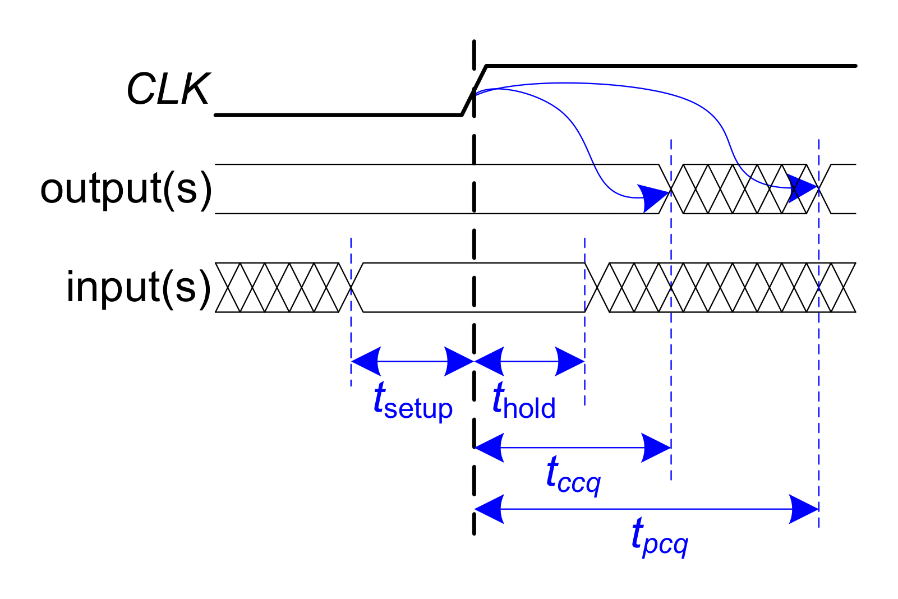
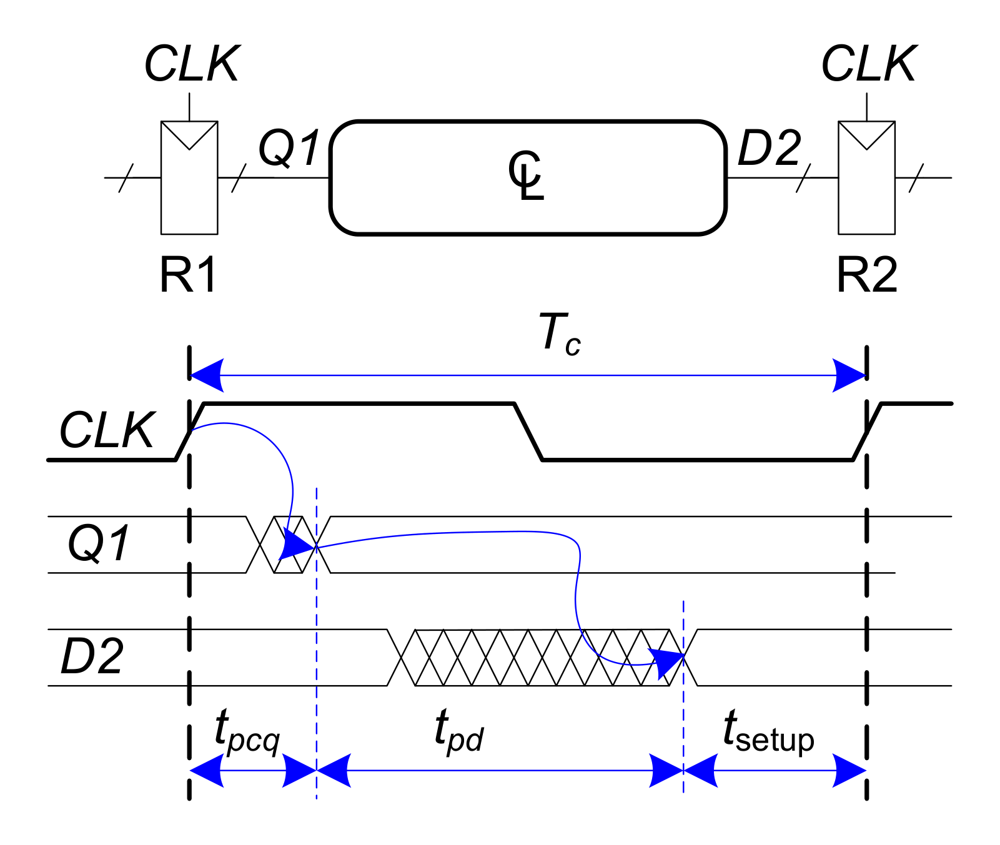
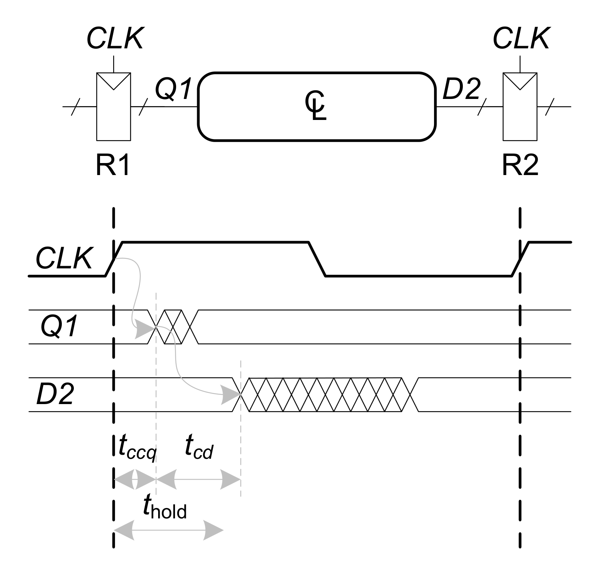
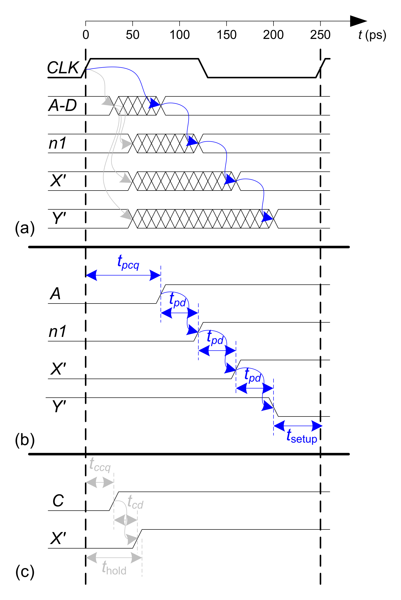

# 体系结构学习笔记

## 单周期微体系结构

以 `lw x6, -4(x9)` 为例，梳理取指、寄存器读取、立即数扩展、地址计算、访存和写回。具体分析见图中标注。


[查看大图](figures/user-lw-datapath-enhanced.png)

补充说明：

- 本例为32位指令，顺序执行时PC加4；图中“每次+1”应改为“每次+4”。
- 图中编号是分析步骤，不代表时钟周期数。
- 最后一幅是下一条 `sw x6, 8(x9)` 指令，展示的是写内存路径。

## 从单周期到流水线

记录无停顿的五级流水线中，写回数据与目标寄存器编号必须保持对应的问题。具体分析见图中标注。


[查看大图](figures/user-pipeline-writeback-enhanced.png)

注：图中的“写回地址”指目标寄存器编号 `rd`，不是数据内存地址；它需要随指令经过各级流水线寄存器。

## 旁路的边界：load-use hazard

学习旁路时留下一个问题：前一条 `lw` 已经进入 MEM，为什么不能直接把结果交给正在 EX 的下一条指令？

这里采用教材中的五级流水线：`IF → ID → EX → MEM → WB`，访存在 MEM 阶段用一个周期完成，并支持从 MEM/WB 向 EX 旁路。

### EX/MEM 中保存的是地址

```asm
lw  x5, 0(x1)
add x6, x5, x3
```

假设 `x1 = 0x1000`、`x3 = 4`，从内存地址 `0x1000` 读出的32位数据为 `10`（十进制）。正确执行后应有 `x5 = 10`、`x6 = 14`。

`lw` 在 EX 阶段算出的是有效地址 `0x1000`，到 MEM 阶段才读取该地址中的数据。因此，当 `lw` 在 MEM、后一条 `add` 试图进入 EX 时：

| 检查项 | 当前内容 |
|---|---|
| EX/MEM 中的目标寄存器编号 | `rd = 5`，与 `add.rs1` 匹配 |
| EX/MEM 中的 ALU 结果 | 地址 `0x1000` |
| `add` 真正需要的操作数 | 内存中读出的数据 `10` |

如果只因寄存器编号匹配，就把 EX/MEM 中的 ALU 结果旁路给 `add`，实际计算会变成：

```text
错误旁路：x6 = 0x1000 + 4 = 0x1004
正确结果：x6 = 10 + 4     = 14
```

寄存器编号匹配只能说明存在依赖，还要确认旁路来源中保存的是这条指令需要的值。

### 为什么不能直接使用本周期 MEM 读出的数据

对 `add`、`sub` 这类算术指令，EX 结束时已经得到待写回的运算结果；对 `lw`，还要继续经过 MEM 才能取得待写回的数据。

当前五级设计没有把“本周期读取内存，再用读出值完成本周期 ALU 运算”串成一条执行路径。若专门增加这种路径，就要重新评估内存读取与 ALU 运算串联后的时序，不能沿用当前设计的时钟周期假设。

所以，在这里，旁路本身不能消除紧邻的 load-use 依赖，需要先停顿一个周期。

### 停顿一个周期，再旁路

让 `add` 留在 ID，并向 EX 插入一个气泡；`lw` 继续向后执行。处理后的关键周期如下：

| 指令 | 第3周期 | 第4周期 | 第5周期 |
|---|---|---|---|
| `lw x5, 0(x1)` | EX：计算地址 | MEM：读取数据 `10` | WB |
| `add x6, x5, x3` | ID | ID：保持，尚未进入 EX | EX：计算 `10 + 4` |

第4周期的 EX 阶段是气泡。到第5周期，加载结果 `10` 已保存在 MEM/WB 中，可以旁路到 `add` 的 ALU 输入 A，正确算出 `14`。停顿时前面的取指也需要保持，让等待中的指令不被覆盖。

**本例的处理是“停顿一个周期，再旁路”。** 如果两条指令之间原本就有一条无关指令，使 `add` 到第5周期才进入 EX，则在相同假设下无需额外停顿，仍可从 MEM/WB 取得加载结果。

本节数值与指令来自学习讨论；五级流水线的加载依赖及停顿机制参见[Harris 第7章配套讲义，第118–120页](https://pages.hmc.edu/harris/class/e85/DDCArv_Ch7.pdf#page=118)。

图源：Harris《Digital Design and Computer Architecture: RISC-V Edition》相关教学数据通路，个人整理与批注。

## 记分牌的硬件实现


图按 Hennessy 与 Patterson《Computer Architecture: A Quantitative Approach》第 6 版附录 C §C.7 的教材图清晰化。上方数据总线传输操作数和运算结果，下方控制／状态线在记分牌、寄存器堆和功能单元之间传递状态与控制信号。[教材配套页](https://shop.elsevier.com/books/book-companion/9780128119051)

```asm
fmul.d f0, f2, f4    # 乘法单元 MUL0 将结果写入 f0
fadd.d f6, f0, f8    # 加法单元 ADD0 要读 f0 和 f8
```

**发射时查表并锁存。** 乘法发射后，寄存器写者表中 `writer[f0] = MUL0`。本例假设 `f8` 已就绪。加法译码后，组合逻辑用 `f0`、`f8` 和 `f6` 的寄存器编号并行查表。若 `ADD0` 空闲且 `f6` 没有在途写者，加法在时钟沿占用 `ADD0`。这次发射在同一个时钟沿更新两张表。

| 写入位置 | 锁存内容 |
|---|---|
| 功能单元状态表的 `ADD0` 项 | 源寄存器 `f0, f8`，目的寄存器 `f6`。第一个源等待 `MUL0`，第二个源已就绪。 |
| 寄存器写者表的 `f6` 项 | `writer[f6] = ADD0`。后续读取 `f6` 的指令可以查到生产者。 |

**写回时匹配生产者。** `MUL0` 实际把结果写入寄存器堆时，记分牌收到实际写回信号和单元编号。比较器将编号与各个等待标签比较。`ADD0` 的第一个源匹配 `MUL0`，所以在写回沿被标为就绪。`f0` 的在途写者记录同时清除。

**操作数就绪后驱动读端口。** 当 `ADD0` 仍处于等待读取状态、两个源都就绪且读端口授权给它，记分牌用锁存的 `f0`、`f8` 编号选择寄存器堆读地址。两个操作数经数据总线送到 `ADD0`，加法随后进入执行。

## 从建立与保持时间到流水切分

两个寄存器用同一个时钟。每到上升沿，R2 采样输入端已有的数据，R1 同时采样自己的输入，随后从 Q 端送出下一笔。R1 发出的新值**不能太早到**，否则会干扰 R2 这一次采样。它也**不能太晚到**，否则会错过下一次采样。

### 图 3.37｜为什么输入已经变了，输出还没变？



先看输入 D。它在上升沿前要提前稳定 `t_setup`，在沿后还要保持 `t_hold`。再看输出 Q。触发器在上升沿采到的数据，最早经过 `t_ccq` 才会影响 Q，最迟经过 `t_pcq` 后 Q 会稳定。

图里 D 的保持窗口早于 Q 的最早变化时刻结束，所以 D 可以为下一拍变化，这一拍采到的值随后才反映到 Q 上。两者都从同一个上升沿计时，分别看的是输入和输出。

### 图 3.39｜新值最迟什么时候要到？



从图的右边往左看。R2 在**下一个上升沿**采样，所以 D₂ 最晚要在 `T_c − t_setup` 时稳定。再扣掉 R1 从当前沿到 Q₁ 稳定所需的 `t_pcq`，剩下的就是组合逻辑可用的时间。

**为什么这里用减法？** 因为在算预算。实际组合逻辑的最大延迟要满足 `t_pd ≤ T_c − t_pcq − t_setup`。刚好用完预算时才取等号。

### 图 3.40｜新值最早什么时候可以到？



这次看**左边的上升沿**。R2 此刻要采到 D₂ 的旧值，所以 D₂ 至少要保持到 `t_hold`。同一个沿，R1 已经开始发出新数据。Q₁ 最早经过 `t_ccq` 会动，变化再经过组合逻辑的最小延迟 `t_cd` 才可能到达 D₂。时钟沿对齐时，保持约束就是 `t_ccq + t_cd ≥ t_hold`。图 3.40 里，D₂ 的第一处交叉在 `t_hold` 箭头终点右边，所以这条路径满足保持要求。

**这和图 3.37 矛盾吗？** 如果图 3.37 画的是 R2，它的 Q 是 R2 自己的输出 Q₂。图 3.40 要计算 R2 的输入 D₂ 何时受影响，所以从上游 R1 的输出 Q₁ 算起。

### 图 3.43｜为什么越短的路径也可能出问题？



- **(a) 先看阴影的两头。** 左边界表示信号最早可能开始变，右边界表示最迟能稳定。一个节点可以被多条路径影响。
- **(b) 看最长路径。** 沿 `A → n₁ → X′ → Y′`，上游输出最迟在 `80 ps` 稳定，再过三个门各 `40 ps`，Y′ 到 `200 ps` 才稳定。下一个上升沿在 `250 ps`，正好留出 `50 ps` 的建立时间。
- **(c) 看最短路径。** 当 `A = 0` 且 C 从 `0` 变为 `1` 时，C 最早在 `30 ps` 变化，再过一个门的 `25 ps`，X′ 在 `55 ps` 就可能离开旧值。接收端要它保持到 `60 ps`，所以 hold slack 是 `55 − 60 = −5 ps`。

图 3.37、3.39、3.40 和 3.43 取自 Harris & Harris 的 *Digital Design and Computer Architecture: RISC-V Edition* §3.5。 [教材原版图集](https://pages.hmc.edu/harris/ddca/ddcarv.html)

### 写 Verilog 时，怎么知道有没有 hold 违例？

```verilog
always @(posedge clk) begin
    q1 <= din;
    q2 <= q1;
end
```

RTL 仿真里，`q2` 在上升沿读的是沿前的 `q1`。实际电路能否可靠采到这个旧值，要在布局布线后看 Vivado 的 **Hold（Min Delay）**，沿 `q1.Q → q2.D` 查最早到达时间和保持截止时间。报告也会算上两端的时钟路径。 [Vivado 时序路径明细](https://docs.amd.com/r/en-US/ug906-vivado-design-analysis/Timing-Path-Details)

**Hold 余量大也不好吗？缓冲器怎么加？** 正的 hold 余量越大，最早到达时间离保持截止越远。如果靠增加数据路径延迟获得这些余量，还要确认新值能按时赶到下一拍。普通 Verilog 的 `assign q1_buf = q1;` 只是连线，综合可能把它折叠。Vivado 可以绕线，或在物理优化时插入实现恒等逻辑的 `LUT1`。它增加的是传播时间，数据依然在原来的时钟沿采样。实际增加多少，以实现后的 setup 和 hold 报告为准。 [Vivado 保持修复](https://docs.amd.com/r/2023.2-English/ug949-vivado-design-methodology/Fixing-Large-Hold-Violations-Prior-to-Routing)

### 流水线切得更细，第一笔会更快吗？

三段逻辑依次耗时 `2 / 3 / 1 ns`，每一级还要留出 `0.2 ns` 给时钟到输出和建立时间。假设请求相互独立、每拍都能接收、保持约束已满足。

| 指标 | 两级 `[2] → [3+1]` | 三级 `[2] → [3] → [1]` |
|---|---:|---:|
| 最短时钟周期 | `4.2 ns` | `3.2 ns` |
| 首笔到输出采样沿 | `8.4 ns` | `9.6 ns` |
| 理想启动间隔（II） | `1 拍 = 4.2 ns` | `1 拍 = 3.2 ns` |

**为什么首笔延迟还要算到采样沿？** 以两级为例，输出寄存器的 D 端要在 `8.4 ns − t_setup` 前稳定，输出寄存器在 `8.4 ns` 采样。若要等到它的 Q 端稳定，还要加上输出寄存器的时钟到输出延迟。

**为什么 II 只有一拍？** 两级方案中，第一笔在 `0 ns` 进入。到 `4.2 ns`，级间寄存器接住第一笔的中间结果，输入寄存器同时接住第二笔。接下来两个级各忙一笔。第一笔走完全程要两拍，前后两笔进来的间隔只有一拍。

从空流水线连续送入 `N` 笔，最后一笔的采样时间等于 `首笔延迟 + (N−1) × II`。两级先出第一笔，三级每多一笔追回 `1.0 ns`。到 **第 3 笔**，三级在 `16.0 ns` 完成，两级在 `16.8 ns` 完成。
