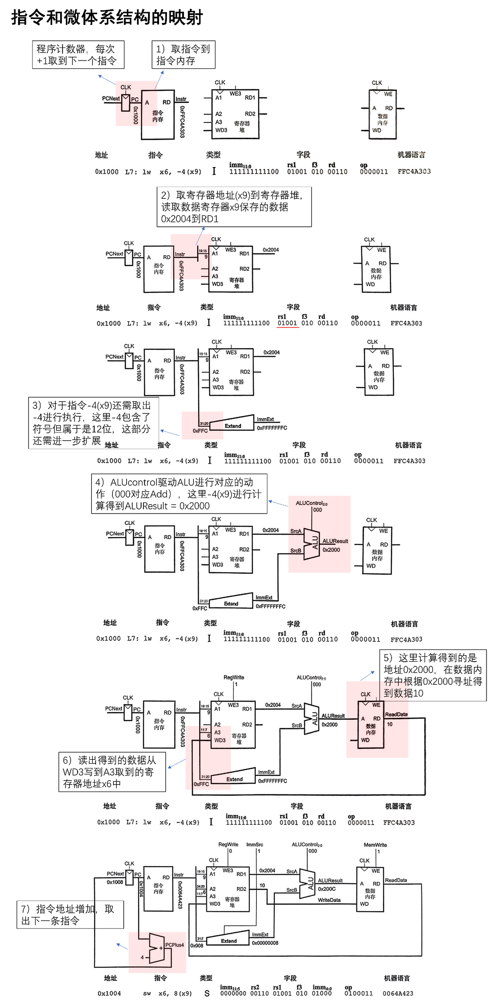
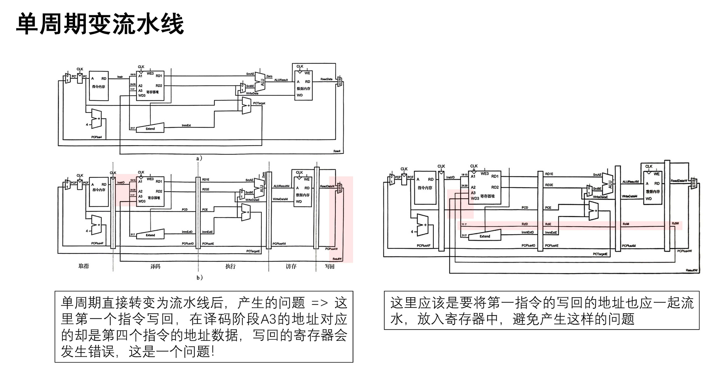
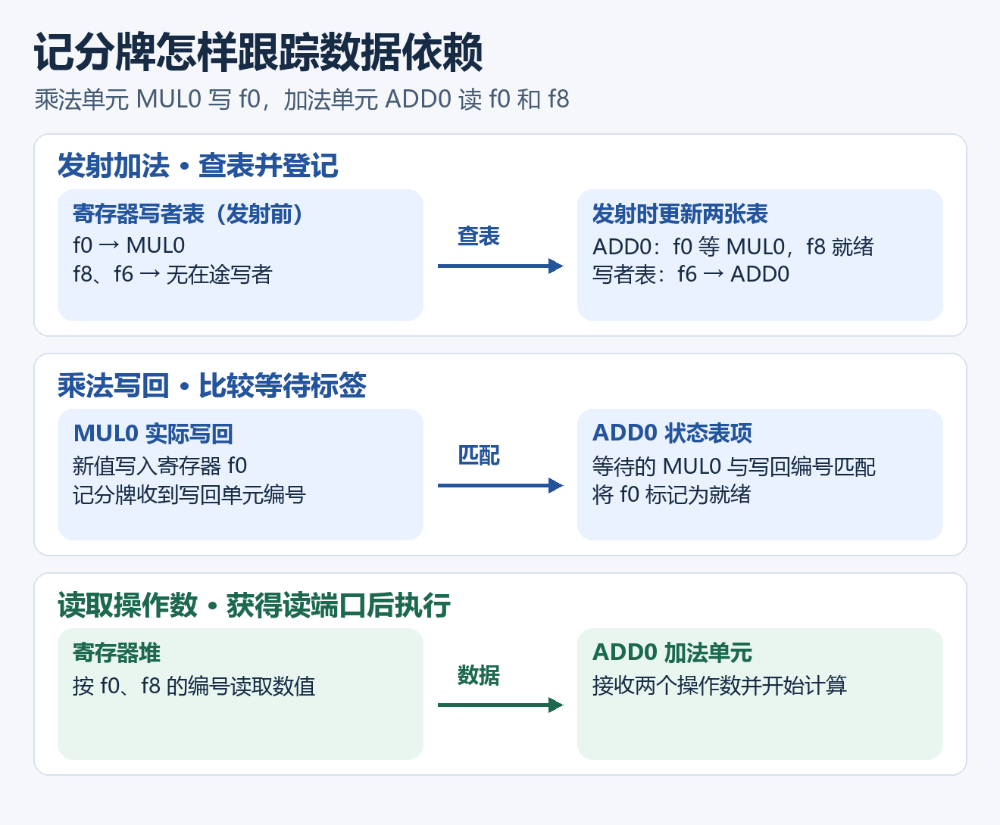

# 体系结构学习笔记

## 单周期微体系结构

以 `lw x6, -4(x9)` 为例，梳理取指、寄存器读取、立即数扩展、地址计算、访存和写回。具体分析见图中标注。



[查看大图](figures/user-lw-datapath-enhanced.png)

补充说明：

- 本例为32位指令，顺序执行时PC加4；图中“每次+1”应改为“每次+4”。
- 图中编号是分析步骤，不代表时钟周期数。
- 最后一幅是下一条 `sw x6, 8(x9)` 指令，展示的是写内存路径。

## 从单周期到流水线

记录无停顿的五级流水线中，写回数据与目标寄存器编号必须保持对应的问题。具体分析见图中标注。



[查看大图](figures/user-pipeline-writeback-enhanced.png)

注：图中的“写回地址”指目标寄存器编号 `rd`，不是数据内存地址；它需要随指令经过各级流水线寄存器。

## 旁路的边界：load-use hazard

学习旁路时留下一个问题：前一条 `lw` 已经进入 MEM，为什么不能直接把结果交给正在 EX 的下一条指令？

这里采用教材中的五级流水线：`IF → ID → EX → MEM → WB`，访存在 MEM 阶段用一个周期完成，并支持从 MEM/WB 向 EX 旁路。

### EX/MEM 中保存的是地址

```asm
lw  x5, 0(x1)
add x6, x5, x3
```

假设 `x1 = 0x1000`、`x3 = 4`，从内存地址 `0x1000` 读出的32位数据为 `10`（十进制）。正确执行后应有 `x5 = 10`、`x6 = 14`。

`lw` 在 EX 阶段算出的是有效地址 `0x1000`，到 MEM 阶段才读取该地址中的数据。因此，当 `lw` 在 MEM、后一条 `add` 试图进入 EX 时：

| 检查项 | 当前内容 |
|---|---|
| EX/MEM 中的目标寄存器编号 | `rd = 5`，与 `add.rs1` 匹配 |
| EX/MEM 中的 ALU 结果 | 地址 `0x1000` |
| `add` 真正需要的操作数 | 内存中读出的数据 `10` |

如果只因寄存器编号匹配，就把 EX/MEM 中的 ALU 结果旁路给 `add`，实际计算会变成：

```text
错误旁路：x6 = 0x1000 + 4 = 0x1004
正确结果：x6 = 10 + 4     = 14
```

寄存器编号匹配只能说明存在依赖，还要确认旁路来源中保存的是这条指令需要的值。

### 为什么不能直接使用本周期 MEM 读出的数据

对 `add`、`sub` 这类算术指令，EX 结束时已经得到待写回的运算结果；对 `lw`，还要继续经过 MEM 才能取得待写回的数据。

当前五级设计没有把“本周期读取内存，再用读出值完成本周期 ALU 运算”串成一条执行路径。若专门增加这种路径，就要重新评估内存读取与 ALU 运算串联后的时序，不能沿用当前设计的时钟周期假设。

所以，在这里，旁路本身不能消除紧邻的 load-use 依赖，需要先停顿一个周期。

### 停顿一个周期，再旁路

让 `add` 留在 ID，并向 EX 插入一个气泡；`lw` 继续向后执行。处理后的关键周期如下：

| 指令 | 第3周期 | 第4周期 | 第5周期 |
|---|---|---|---|
| `lw x5, 0(x1)` | EX：计算地址 | MEM：读取数据 `10` | WB |
| `add x6, x5, x3` | ID | ID：保持，尚未进入 EX | EX：计算 `10 + 4` |

第4周期的 EX 阶段是气泡。到第5周期，加载结果 `10` 已保存在 MEM/WB 中，可以旁路到 `add` 的 ALU 输入 A，正确算出 `14`。停顿时前面的取指也需要保持，让等待中的指令不被覆盖。

**本例的处理是“停顿一个周期，再旁路”。** 如果两条指令之间原本就有一条无关指令，使 `add` 到第5周期才进入 EX，则在相同假设下无需额外停顿，仍可从 MEM/WB 取得加载结果。

本节数值与指令来自学习讨论；五级流水线的加载依赖及停顿机制参见[Harris 第7章配套讲义，第118–120页](https://pages.hmc.edu/harris/class/e85/DDCArv_Ch7.pdf#page=118)。

图源：Harris《Digital Design and Computer Architecture: RISC-V Edition》相关教学数据通路，个人整理与批注。

## 记分牌的硬件实现

经典记分牌用**寄存器写者表**记录每个寄存器的在途写者，用**功能单元状态表**记录指令的源和目的寄存器，以及各源操作数在等哪个单元写回。[Hennessy 与 Patterson，第 6 版附录 C §C.7](https://shop.elsevier.com/books/book-companion/9780128119051)

- **发射。** 功能单元空闲且目的寄存器没有在途写者时，用源寄存器编号查写者表，锁存依赖，并登记目的寄存器的新写者。
- **写回。** 生产者实际写回后，记分牌用它的功能单元编号匹配等待项，将匹配的操作数标为就绪。
- **读取。** 两个源操作数均就绪且获得读端口后，寄存器堆把数值送到功能单元，指令开始执行。


