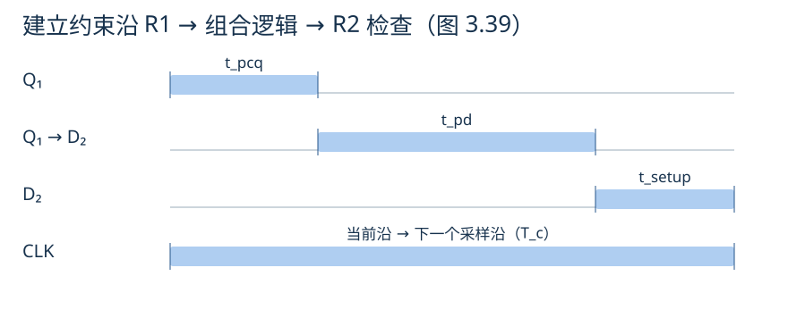
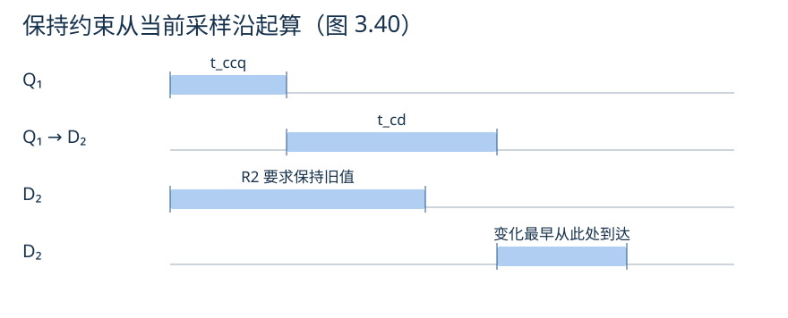
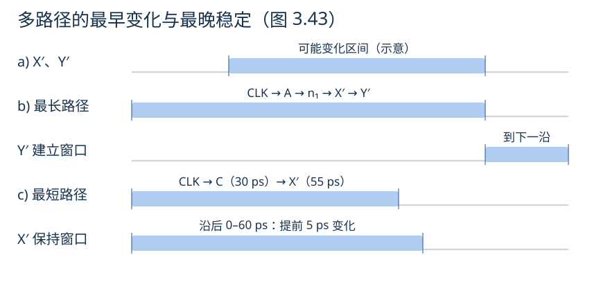

# 体系结构学习笔记

## 单周期微体系结构

以 `lw x6, -4(x9)` 为例，梳理取指、寄存器读取、立即数扩展、地址计算、访存和写回。具体分析见图中标注。


[查看大图](figures/user-lw-datapath-enhanced.png)

补充说明：

- 本例为32位指令，顺序执行时PC加4；图中“每次+1”应改为“每次+4”。
- 图中编号是分析步骤，不代表时钟周期数。
- 最后一幅是下一条 `sw x6, 8(x9)` 指令，展示的是写内存路径。

## 从单周期到流水线

记录无停顿的五级流水线中，写回数据与目标寄存器编号必须保持对应的问题。具体分析见图中标注。


[查看大图](figures/user-pipeline-writeback-enhanced.png)

注：图中的“写回地址”指目标寄存器编号 `rd`，不是数据内存地址；它需要随指令经过各级流水线寄存器。

## 旁路的边界：load-use hazard

学习旁路时留下一个问题：前一条 `lw` 已经进入 MEM，为什么不能直接把结果交给正在 EX 的下一条指令？

这里采用教材中的五级流水线：`IF → ID → EX → MEM → WB`，访存在 MEM 阶段用一个周期完成，并支持从 MEM/WB 向 EX 旁路。

### EX/MEM 中保存的是地址

```asm
lw  x5, 0(x1)
add x6, x5, x3
```

假设 `x1 = 0x1000`、`x3 = 4`，从内存地址 `0x1000` 读出的32位数据为 `10`（十进制）。正确执行后应有 `x5 = 10`、`x6 = 14`。

`lw` 在 EX 阶段算出的是有效地址 `0x1000`，到 MEM 阶段才读取该地址中的数据。因此，当 `lw` 在 MEM、后一条 `add` 试图进入 EX 时：

| 检查项 | 当前内容 |
|---|---|
| EX/MEM 中的目标寄存器编号 | `rd = 5`，与 `add.rs1` 匹配 |
| EX/MEM 中的 ALU 结果 | 地址 `0x1000` |
| `add` 真正需要的操作数 | 内存中读出的数据 `10` |

如果只因寄存器编号匹配，就把 EX/MEM 中的 ALU 结果旁路给 `add`，实际计算会变成：

```text
错误旁路：x6 = 0x1000 + 4 = 0x1004
正确结果：x6 = 10 + 4     = 14
```

寄存器编号匹配只能说明存在依赖，还要确认旁路来源中保存的是这条指令需要的值。

### 为什么不能直接使用本周期 MEM 读出的数据

对 `add`、`sub` 这类算术指令，EX 结束时已经得到待写回的运算结果；对 `lw`，还要继续经过 MEM 才能取得待写回的数据。

当前五级设计没有把“本周期读取内存，再用读出值完成本周期 ALU 运算”串成一条执行路径。若专门增加这种路径，就要重新评估内存读取与 ALU 运算串联后的时序，不能沿用当前设计的时钟周期假设。

所以，在这里，旁路本身不能消除紧邻的 load-use 依赖，需要先停顿一个周期。

### 停顿一个周期，再旁路

让 `add` 留在 ID，并向 EX 插入一个气泡；`lw` 继续向后执行。处理后的关键周期如下：

| 指令 | 第3周期 | 第4周期 | 第5周期 |
|---|---|---|---|
| `lw x5, 0(x1)` | EX：计算地址 | MEM：读取数据 `10` | WB |
| `add x6, x5, x3` | ID | ID：保持，尚未进入 EX | EX：计算 `10 + 4` |

第4周期的 EX 阶段是气泡。到第5周期，加载结果 `10` 已保存在 MEM/WB 中，可以旁路到 `add` 的 ALU 输入 A，正确算出 `14`。停顿时前面的取指也需要保持，让等待中的指令不被覆盖。

**本例的处理是“停顿一个周期，再旁路”。** 如果两条指令之间原本就有一条无关指令，使 `add` 到第5周期才进入 EX，则在相同假设下无需额外停顿，仍可从 MEM/WB 取得加载结果。

本节数值与指令来自学习讨论；五级流水线的加载依赖及停顿机制参见[Harris 第7章配套讲义，第118–120页](https://pages.hmc.edu/harris/class/e85/DDCArv_Ch7.pdf#page=118)。

图源：Harris《Digital Design and Computer Architecture: RISC-V Edition》相关教学数据通路，个人整理与批注。

## 记分牌的硬件实现


图按 Hennessy 与 Patterson《Computer Architecture: A Quantitative Approach》第 6 版附录 C §C.7 的教材图清晰化。上方数据总线传输操作数和运算结果，下方控制／状态线在记分牌、寄存器堆和功能单元之间传递状态与控制信号。[教材配套页](https://shop.elsevier.com/books/book-companion/9780128119051)

```asm
fmul.d f0, f2, f4    # 乘法单元 MUL0 将结果写入 f0
fadd.d f6, f0, f8    # 加法单元 ADD0 要读 f0 和 f8
```

**发射时查表并锁存。** 乘法发射后，寄存器写者表中 `writer[f0] = MUL0`。本例假设 `f8` 已就绪。加法译码后，组合逻辑用 `f0`、`f8` 和 `f6` 的寄存器编号并行查表。若 `ADD0` 空闲且 `f6` 没有在途写者，加法在时钟沿占用 `ADD0`。这次发射在同一个时钟沿更新两张表。

| 写入位置 | 锁存内容 |
|---|---|
| 功能单元状态表的 `ADD0` 项 | 源寄存器 `f0, f8`，目的寄存器 `f6`。第一个源等待 `MUL0`，第二个源已就绪。 |
| 寄存器写者表的 `f6` 项 | `writer[f6] = ADD0`。后续读取 `f6` 的指令可以查到生产者。 |

**写回时匹配生产者。** `MUL0` 实际把结果写入寄存器堆时，记分牌收到实际写回信号和单元编号。比较器将编号与各个等待标签比较。`ADD0` 的第一个源匹配 `MUL0`，所以在写回沿被标为就绪。`f0` 的在途写者记录同时清除。

**操作数就绪后驱动读端口。** 当 `ADD0` 仍处于等待读取状态、两个源都就绪且读端口授权给它，记分牌用锁存的 `f0`、`f8` 编号选择寄存器堆读地址。两个操作数经数据总线送到 `ADD0`，加法随后进入执行。

## 从建立与保持时间到流水切分

### 采样沿前后，分别在等什么？

```text
R1 的 Q ──→ 组合逻辑 ──→ R2 的 D
```


两个寄存器共用一个时钟。当前上升沿，R2 要采到 D 端已有的值，同时 R1 发出下一笔数据。R2 的输入在当前沿后还要保持旧值一段时间，并在下一个沿前提前稳定到新值。

| 要检查的事 | 看哪条时间线 | 时钟沿对齐时的条件 |
|---|---|---|
| 建立（setup） | R1 的 Q 最迟在 `t_pcq` 后稳定，新值最多再经过 `t_pd` 到达 R2 的 D | `T_c ≥ t_pcq + t_pd + t_setup` |
| 保持（hold） | R1 的 Q 最早在 `t_ccq` 后变化，变化最快再经过 `t_cd` 到达 R2 的 D | `t_ccq + t_cd ≥ t_hold` |

**为什么单个触发器的波形里，输入已经变了，输出还没变？** `t_hold` 描述 D 端要保持多久，`t_ccq` 描述 Q 端最早何时变化。如果 `t_hold < t_ccq`，输入可以先动，输出仍在反映上一笔。把两个寄存器接起来后，要用 **R1 的 Q** 计算最快到达时间，用 **R2 的 D** 检查保持窗口。



**为什么组合逻辑的延迟写成减法？** 从下一采样沿往前减去 `t_setup`，得到 D₂ 的稳定截止时间。再减去 Q₁ 最迟出发所需的 `t_pcq`，剩下的是组合逻辑的最大允许延迟。等号表示刚好用完预算。



**两张图是角度不同，还是画错了？这里看的是第二个上升沿吗？** 图 3.40 的两段最小延迟都从左侧当前沿开始追踪。图 3.37 若单独看 R2，图中的 Q 是 Q₂。到了两级路径，计算新变化什么时候抵达 D₂，要从上游 R1 的 Q₁ 开始。两图用的是同一个 `t_ccq` 定义，测量对象取决于所画的寄存器。



**为什么最短路径也会违例？** 教材例子中，R1 的输出最早在 `30 ps` 开始变化，变化经过一个门，最早再过 `25 ps` 就能到达 R2 的 D。此时只过了 `55 ps`，R2 要求旧值保留到 `60 ps`，因此 hold slack 是 `−5 ps`。在这个例子里，旧值会在保持窗口结束前失去保证。

### Verilog 描述采样关系，时序报告给出物理余量

```verilog
always @(posedge clk) begin
    q1 <= din;
    q2 <= q1;
end
```

两个非阻塞赋值在同一个沿读各自的右侧，`q2` 因此采到沿前的 `q1`。实际器件里，这个采样关系能否可靠成立，要在 Vivado 布局布线后的 **Hold（Min Delay）** 报告中检查 `q1.Q → q2.D`。Hold slack 等于最早数据到达时间减去保持截止时间，工具还会计入时钟路径延迟。

**Hold slack 太大也不好吗？缓冲器在 Verilog 里如何实现？** 较大的正 hold slack 本身满足保持要求。若通过给数据路径增加延迟获得，setup 余量可能缩小。AMD FPGA 的一输入 LUT 可以实现恒等逻辑，用 `LUT1 #(.INIT(2'b10)) u_buf (.I0(q1), .O(q1_buf));` 表达，保留该实例后仍须看实现报告。若布线绕行或物理优化插入的 `LUT1` 让这条路径的最小延迟净增加 `10 ps`，上面的 hold slack 会从 `−5 ps` 变成 `+5 ps`。普通 `assign q1_buf = q1;` 只描述逻辑连接，综合通常会把它折叠。物理延迟以实现报告为准。增加路径延迟也可能推迟新值最晚到达的时刻，所以修完 hold 后还要复查 setup。 [Vivado 时序路径明细](https://docs.amd.com/r/en-US/ug906-vivado-design-analysis/Timing-Path-Details) · [Vivado 保持修复](https://docs.amd.com/r/2023.2-English/ug949-vivado-design-methodology/Fixing-Large-Hold-Violations-Prior-to-Routing)

### 结果提前稳定了，延迟为什么还要数到采样沿？

三段组合逻辑的延迟依次为 `2 / 3 / 1 ns`，每级的 `t_pcq + t_setup` 合计为 `0.2 ns`。假设输入独立、每级每拍接收一笔、没有停顿，且保持约束已满足。

| 指标 | 两级 `[2] → [3+1]` | 三级 `[2] → [3] → [1]` |
|---|---:|---:|
| 最短时钟周期 | `4.2 ns` | `3.2 ns` |
| 首笔从输入采样沿到输出采样沿 | `2 × 4.2 = 8.4 ns` | `3 × 3.2 = 9.6 ns` |
| 理想启动间隔（II） | `1 拍 = 4.2 ns` | `1 拍 = 3.2 ns` |

以两级方案为例，输出寄存器的 D 端最晚须在 `8.4 ns − t_setup` 稳定，寄存器在 `8.4 ns` 的沿才采样。若从输出 Q 端观察新值，还要等输出寄存器自己的时钟到输出延迟。

**为什么 II 是一拍？** 两级方案中，A 在 `0 ns` 进入。到 `4.2 ns` 的沿，级间寄存器采到 A 的第一级结果，输入寄存器同时接收 B。下一拍内，第一级处理 B，第二级处理 A。于是 A 自己走两拍，相邻两笔只隔一拍。

从空流水线开始连续送入 `N` 笔，最后一笔的采样时间是 `首笔延迟 + (N−1) × II`。两级的第一笔早 `1.2 ns`，三级每多处理一笔追回 `1.0 ns`。所以本例从 **第 3 笔**开始，三级方案更早处理完整批。

时序图与最短路径例子见 Harris & Harris 的 RISC-V 版教材 §3.5，图 3.37–3.43。 [教材作者配套页](https://pages.hmc.edu/harris/ddca/ddcarv.html)
